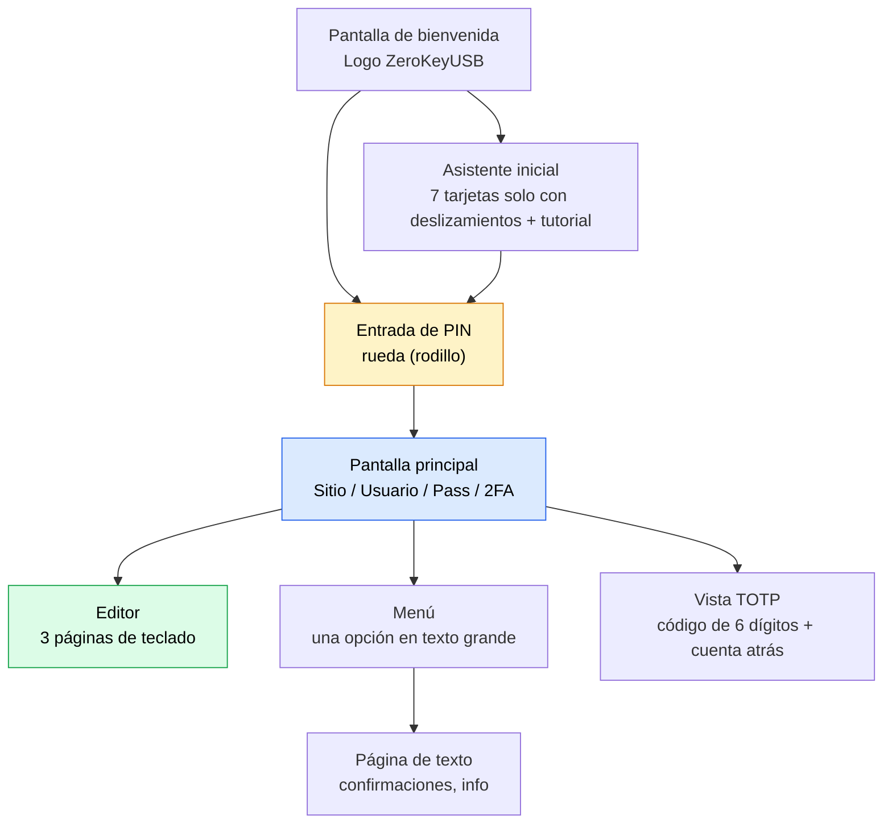
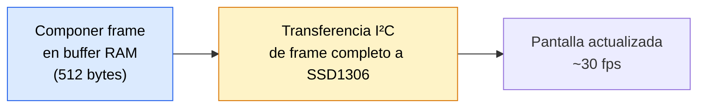

## 128×32 píxeles con propósito

ZeroKeyUSB usa un **panel OLED blanco** (controlador SSD1306, I²C en `0x3C`) con una resolución de 128×32 píxeles.  
El firmware mantiene la interfaz intencionadamente minimalista: tipografía grande, layout claro y transiciones suaves que siguen siendo legibles incluso con poca luz.

---

## Jerarquía de pantallas

---

## Pipeline de renderizado

1. **Construcción del frame buffer** — la aplicación compone toda la pantalla en un buffer RAM de 512 bytes usando funciones de dibujo de `Adafruit_SSD1306`: `setCursor()`, `print()`, `drawRect()`, `fillRect()`, `drawBitmap()`.
2. **Transferencia de frame completo** — `display.display()` envía los 512 bytes al OLED por I²C en una sola ráfaga.
3. **Cadencia de refresco** — el bucle principal cooperativo redibuja solo cuando cambia el estado de la pantalla, evitando tráfico I²C innecesario.

---

## Anatomía de una pantalla (1.1.0)

Desde el firmware 1.1.0 el menú, las cuentas y el asistente comparten una misma disposición, así que se aprende una vez:

| Zona | Filas | Contenido | Fuente |
|------|-------|-----------|--------|
| **Contexto** | 0–6 | Dónde estás: `#3 Gmail > Usuario`, `AJUSTES > Mano`, `2/7 MANO` | 5×7 |
| **Banda** | 7–24 | El valor elegido, negro sobre blanco | FreeSans **Bold** 9 pt; FreeSans 9 pt si no cabe; 5×7 como último recurso (`drawBigText()`) |
| **Pista** | 25–31 | Lo que hay debajo (`↓ Clave`) o una pista de gesto animada | 5×7 / animación |
| **Posición** | x 125–127 | Lugar en la lista (menús) | — |

Reglas que cumple cada pantalla: una idea por pantalla, pistas con símbolos animados en vez de palabras, dos instrucciones nunca comparten fila, y nada cambia sin deslizarse en la dirección del gesto.

---

## Tipos de pantalla

### Pantalla de entrada de PIN ("rodillo")
- Una **rueda** en x 98–117: el valor elegido iluminado en una ventana de 20×16 (FreeSans Bold), el anterior encima y el siguiente debajo (5×7). Tras el primer dígito la rueda tiene `0, ✓, 1 … 9`.
- Los dígitos ya introducidos se dibujan en grande a la izquierda de la rueda, separados 20 px, el más nuevo junto a ella; los antiguos salen por el borde izquierdo.
- Una flecha junto a la rueda late hacia la fila (o, en modo Botones, hacia el pad Derecha).
- Arriba/Abajo hace rodar el valor dentro de su ventana (un deslizamiento vertical limitado a ese recuadro). Al añadir un dígito, este viaja de la ventana a la fila mientras la fila se desplaza un paso a la izquierda (6 fotogramas, ~110 ms); al borrar, lo contrario. La animación se reconstruye a partir del estado en pantalla: no se guarda ninguna copia extra del PIN.

### Pantalla principal de credenciales
- Fila de contexto: `#N > Sitio` en el campo sitio, `#N <sitio> > <campo>` en los demás.
- Banda: el campo elegido en grande: sitio, usuario, **contraseña** o `2FA (OK)` / nota. Los valores más anchos que la banda se desplazan dentro de ella (FreeSans 9 pt, ~40 px/s, pausa de 1,2 s en cada extremo) mediante `refreshMainScrollIfNeeded()`.
- Fila de pista: `↓ <usuario>` bajo el sitio, `↓ Clave` bajo el usuario (el nombre, nunca el valor), `↓ 2FA` bajo la contraseña si el hueco tiene.
- El hueco virtual tras la última cuenta muestra `NUEVA CUENTA` / `+ Nueva`.

### Pantalla de editor
- **Tres páginas de teclado** seleccionables con Arriba/Abajo:
  - Página 1 (`EDIT_KB1`): `A-Z`, corchetes, símbolos
  - Página 2 (`EDIT_KB2`): `a-z`, puntuación
  - Página 3 (`EDIT_KB3`): `0-9`, espacio, caracteres especiales
- Controles Izquierda/Derecha: posición del cursor (◀ / ▶), carácter aleatorio, retroceso
- Carácter seleccionado resaltado con colores invertidos

### Pantalla de menú
- Una opción cada vez: la ruta (`AJUSTES > Mano`) en la fila de contexto, el valor (`Diestro`) en grande en la banda, la opción siguiente debajo y una barra de posición de 3 px a la derecha.
- Las opciones con forma `Nombre: valor` muestran el nombre en la ruta y el valor en la banda.

### Tarjetas del asistente
- Siete tarjetas con la misma disposición: idioma, mano, (tutorial), teclado, crear PIN, PIN guardado, listo.
- Las tarjetas con elección reservan una columna de 7 px a la derecha para una doble flecha animada que crece desde el centro hacia los dos extremos (`drawGrowArrowVertical()`: desliza arriba o abajo para cambiar). Todas tienen una flecha que se desliza de derecha a izquierda por la fila de abajo (`drawGlideArrow()`: desliza así para seguir). Las dos pistas se turnan (~1 s cada una, fotogramas de 90 ms) para que solo se mueva una cosa a la vez.

### Tutorial
- Seis lecciones interactivas (`zerokey-tutorial.cpp`): una cruz de pads a la izquierda anima el movimiento, el panel derecho nombra la acción, y el usuario tiene que hacerla. Una tarjeta resumen se cierra con la misma flecha deslizante.

### Avisos y pantallas finales
- `renderBigNotice()`: barra de título pequeña y el valor en grande (p. ej. `Orientacion` / `Zurdo` tras un cambio).
- Tras un reset de fábrica el dispositivo muestra una tarjeta fija `RESET COMPLETADO` / `Desconectalo` y deja de responder a los pads hasta que se desconecta.

### Pantalla de código TOTP
- El código de 6 dígitos a **doble tamaño** (filas 16–31) bajo el título.
- Los segundos que quedan, alineados a la derecha en la fila del título (`23s`), y una barra de 2 px en las filas 10–11 que se vacía durante la ventana de 30 s (1.1.0; antes la cuenta atrás se imprimía en y = 40, por debajo del panel, y nunca se veía).
- El bucle principal lo comprueba cada 200 ms y redibuja cuando cambia el segundo o el código; cada paso de 30 s se calcula un código nuevo.
- Aquí solo responde Centro: teclea el código por USB HID y vuelve al campo 2FA de la cuenta. Los demás pads no hacen nada.

---

## Tipografía y assets

| Asset | Formato | Tamaño | Uso |
|-------|--------|------|-------|
| **Fuente por defecto** | Adafruit GFX incluida | 6×8 px | Filas de contexto y de pista, páginas de texto |
| **FreeSans 9 pt Bold / Regular** | Fuentes Adafruit GFX | altura de mayúscula 12 px, ~1,9 KB cada una | La banda, los dígitos del PIN (1.1.0) |
| **Tamaño de texto 2** | escalado 2× | 12×16 px | Códigos TOTP, pantalla de inicio |
| **Iconos** | bitmaps PROGMEM | 16×16 px | Ítems del menú (backup, settings, danger, info) |
| **SVGs del dispositivo** | Vector en `/images/` | Varios | Ilustraciones de pads táctiles en la documentación |

Todas las fuentes e iconos se almacenan en **Flash (PROGMEM)** — sin carga en runtime desde EEPROM.

---

## Transiciones deslizantes (1.1.0)

Las pantallas están dispuestas como una tira (el menú a la izquierda de la cuenta 1, las cuentas de izquierda a derecha, los submenús a la derecha de su menú, la búsqueda encima de la cuenta) y moverse por ella hace entrar la pantalla nueva por ese lado.

1. Antes de atender una pulsación, `requestTransition()` copia el fotograma en pantalla (`slideFor()` en `zerokey-io.cpp` elige la dirección).
2. Cuando el manejador redibuja, `zerokeydisplay()` envía **5 fotogramas intermedios** que desplazan el fotograma viejo y el nuevo (columnas en los deslizamientos horizontales, bits de cada columna en los verticales) y después el definitivo. Cada envío tarda ~13 ms (el driver sube el bus a 400 kHz para los fotogramas), así que un deslizamiento cuesta ~80 ms.
3. Se tiene en cuenta la orientación: en Diestro, la opción predeterminada, el panel está girado 180°, así que "por la derecha" para el usuario es "por la izquierda" en el búfer.

| Movimiento | Deslizamiento |
|------------|---------------|
| Cuenta siguiente / anterior | Horizontal, pantalla completa |
| Opción del menú o campo de la cuenta siguiente / anterior | Vertical, filas 7–31 (la fila de contexto queda quieta) |
| Entrar en un submenú / volver | Horizontal |
| Abrir la búsqueda / volver a la cuenta | Vertical, pantalla completa |
| Rueda del PIN | Vertical, solo dentro de la ventana del valor (`requestBoxTransition()`) |

Si el manejador no cambió nada, no hay animación. La repetición automática (deslizar y mantener) no anima, para que las listas vayan a toda velocidad, salvo la rueda del PIN, cuyo rodar cabe de sobra en los 180 ms entre repeticiones.

## Scroll

- **Marquesina en la banda**: los valores más anchos que la banda se desplazan en horizontal (ver la pantalla principal).
- **Páginas de texto**: las páginas de confirmación e info se desplazan en vertical con Arriba/Abajo y muestran una barra de scroll.

---

## Feedback visual

| Tipo de feedback | Implementación |
|--------------|----------------|
| **Resaltado de selección** | Colores invertidos (texto negro sobre fondo blanco) |
| **Progreso de pulsación larga** | Dos plumas blancas se llenan por el borde de la pantalla vía `drawLongPressProgress()`, con un cabezal negro por delante de cada una para seguir el avance con claridad |
| **Spinner de actividad** | Animación basada en frames vía `renderActivityScreen()` |
| **Barra de progreso** | `renderProgress()` con título, subtítulo, hecho/total |
| **Indicador de tecleo** | `renderTypingActivity()` muestra caracteres tecleados vs. total |
| **Fila de contexto** | La fila superior muestra dónde estás (`#3 Gmail > Usuario`, `AJUSTES > Mano`) |
| **Aviso de gesto** | `renderGestureHint()`: una cruz de pads con el deslizamiento que hay que hacer, visible 1,2 s al tocar un pad exterior solo en modo Gestos |

---

## Apagado por inactividad

Tras **1 minuto sin ninguna pulsación táctil**, el firmware apaga el OLED
(`SSD1306_DISPLAYOFF`) desde `handleButtonChecker()`. Es un apagado **solo de la
pantalla**:

- La bóveda **no** se bloquea y `programPosition` no cambia — al despertar
  aparece exactamente la misma pantalla.
- **Cualquier toque** enciende el panel (`SSD1306_DISPLAYON`); ese primer toque
  se consume, así que solo despierta y no navega además.
- Un `FIND` del host desde la [extensión de navegador](/es/getting-started/browser-extension)
  también enciende el panel para que el salto sea visible.

El MCU sigue funcionando mientras está apagado (temporizadores, pasos TOTP,
serie). Los redibujados periódicos automáticos (p. ej. la cuenta atrás del TOTP)
**no** cuentan como actividad — solo el táctil y los comandos del host.

---

## Seguridad del display

- Los campos sensibles (contraseñas, códigos TOTP) se **muestran brevemente y se borran** — el frame buffer se sobrescribe en la siguiente transición.
- El display **se apaga tras 1 minuto de inactividad pero no se bloquea** (ver arriba); bloquear la bóveda sigue requiriendo quitar la alimentación (desconexión USB).
- Mientras se teclea al host, `renderTypingActivity()` muestra progreso sin mostrar el contenido de la credencial.
- Ninguna credencial descifrada se guarda en la GDDRAM del controlador OLED más allá del frame actual.

<Note>
El OLED queda detrás del encapsulado epoxy sellado, proporcionando excelente contraste y resistencia a arañazos, polvo y humedad.
</Note>
