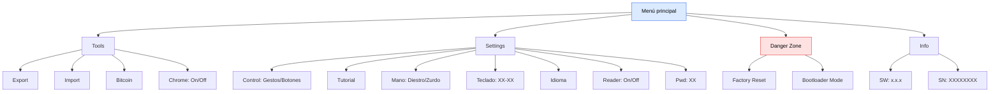
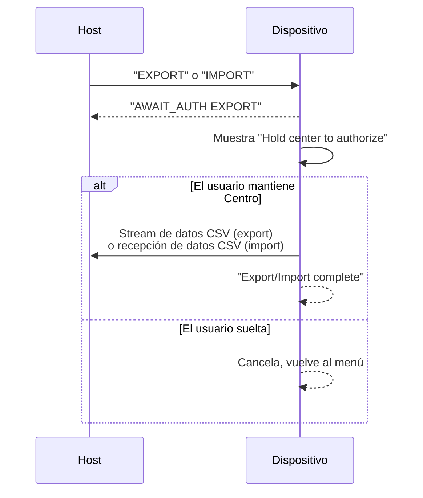
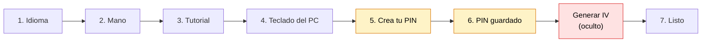

## Control simple, funciones potentes

ZeroKeyUSB no tiene botones, ni apps, ni menús ocultos — solo **cinco puntos táctiles dorados** que lo controlan todo.  
El menú es accesible **tras introducir tu PIN maestro** haciendo scroll más allá del último slot de credenciales.

---

## Estructura del menú

---

## Navegación del menú

| Acción | Gestos | Efecto |
|--------|--------|--------|
| **Arriba ↑** | Deslizar de arriba a abajo | Opción anterior |
| **Abajo ↓** | Deslizar de abajo a arriba | Opción siguiente |
| **Centro ●** | Tocar el centro | Abrir el submenú / ejecutar la opción |
| **Izquierda ←** | Deslizar de izquierda a derecha | Volver al menú padre; desde el menú principal, salir al hueco "+ Nueva" (o a la última cuenta si todos los huecos están usados) |
| **Derecha →** | Deslizar de derecha a izquierda | Salir del menú a la cuenta 1, desde cualquier nivel |

Desde la 1.1.0 el menú muestra **una opción cada vez** en texto grande (`ZerokeyMenu::displayMenu()`): la ruta en la fila de arriba, el valor en la banda, la opción siguiente debajo y una barra de posición a la derecha. Arriba/Abajo se deslizan en vertical bajo la fila de ruta; entrar o salir de un submenú se desliza en horizontal (ver [Sistema de pantalla](/es/firmware/display)).

---

### 🧰 Tools

<Note>Este submenú se llamaba **Backup** en firmware anteriores; se renombró a **Tools** al añadir la cartera Bitcoin.</Note>

| Ítem | Acción |
|------|--------|
| **Import** | Recibe credenciales desde el host vía USB serie (CDC). El dispositivo muestra "Waiting for data from the web app". |
| **Export** | Envía los 61 slots de credenciales como CSV en texto plano por USB serie. Requiere autorización con pulsación larga Centro. |
| **Bitcoin** | Cartera Bitcoin airgapped: crear cartera, mostrar la semilla de 12 palabras (solo pantalla) y exportar un `zpub` watch-only. Ver [Firmante Bitcoin](/es/firmware/bitcoin-signer). |
| **Chrome: On/Off** | Habilita el comando host `FIND` que usa la [extensión de navegador](/es/getting-started/browser-extension) para saltar la búsqueda del dispositivo. Por defecto **On**; en Off el firmware ignora el comando. Guardado en EEPROM (`0x000D`). |

El flujo de export/import muestra un prompt de autorización antes de transferir cualquier dato:

<Warning>
Export envía **credenciales en texto plano** por USB serie. Solo realiza esto en un ordenador de confianza.
</Warning>

---

### ⚙️ Settings

| Ítem | Acción |
|------|--------|
| **Control: Gestos / Botones** | Modo de entrada (1.1.0): deslizar por los pads o pulsarlos uno a uno. Guardado en EEPROM (`0x000E`; en blanco = Botones, así los equipos actualizados desde la 1.0 conservan su comportamiento). Al cambiar a Gestos se abre el tutorial. Ver [Gestión del táctil](/es/firmware/io-touch-handling). |
| **Tutorial** | Repite el tutorial animado e interactivo (`runInputTutorial()`). |
| **Mano: Diestro / Zurdo** | Gira la pantalla 180° y reasigna los pads para que "arriba" siga siendo el pad de arriba de la pantalla. Diestro (rotación del panel 2) es el predeterminado. Guardado en EEPROM. |
| **Keyboard: XX-XX** | Cicla por los 9 layouts de teclado (EN-US → DA-DK → DE-DE → ES-ES → FR-FR → HU-HU → IT-IT → PT-PT → SV-SE → EN-US). Guardado en EEPROM. |
| **UI Language** | Cicla el idioma de la interfaz en pantalla (Inglés ↔ Español). Guardado en EEPROM. |
| **Reader: On/Off** | Alterna el [modo lector de pantalla](/es/firmware/screen-reader) HID persistente — teclea la pantalla por USB para que una unidad con el display muerto siga siendo usable. Guardado en EEPROM. |
| **Pwd: XX** | Cicla el formato que usa `Rand` al generar una contraseña: `Symbols` → `Numeric` → `a-z 0-9` → `Aa-z 0-9` → `Words` → `Words+Num`. Todos los formatos salen del TRNG del ATECC608A y topan en 16 caracteres. Guardado en EEPROM (`0x0004`). Ver [Editar una credencial](/es/getting-started/edit-credential). |

---

### ⏱️ TOTP

El TOTP se accede desde la vista de credenciales, no desde el menú principal. Al ver una credencial, haz scroll **Abajo más allá de Password** hasta el campo **2FA**:

- Si no existe secreto TOTP para ese slot → muestra "No TOTP secret" durante 2 segundos.
- Si la hora no está sincronizada → muestra "Time not set — Request host time" y envía `REQTIME` por serie.
- Si está listo → muestra un **código de 6 dígitos** con cuenta atrás de 30 segundos. Se refresca automáticamente cada periodo. Toca cualquier pad para volver.

---

### ⚠️ Danger Zone

Toda acción en esta sección muestra una **página de confirmación** que solo se dispara **manteniendo** el centro 1,5 s (un toque no hace nada); Izquierda cancela:

| Ítem | Efecto | ¿Reversible? |
|------|--------|-------------|
| **Factory Reset** | Ejecuta `eraseAll()` (cuenta atrás de 3 segundos, blancos cifrados en los 61 slots + limpia metadatos TOTP) y resetea el flag de aprovisionamiento a `0x00`, así el próximo arranque inicia el asistente de setup. Después muestra una tarjeta fija de "desconéctalo" y se detiene: no responde a ningún pad hasta que se desconecta. | ❌ No |
| **Bootloader Mode** | Pone la palabra mágica de doble reset (`0xF01669EF` en `0x20007FFC`) y luego ejecuta `NVIC_SystemReset()`. El dispositivo se reinicia en el bootloader USB DFU para flashear firmware. | ✅ Sí (reflasheo) |

---

### ℹ️ Info

Submenú de solo lectura mostrando:
- **SW: x.x.x** — versión del firmware desde `zerokeyInfo::getSoftwareVersion()` (`1.1.0`)
- **SN: XXXXXXXX** — serial hardware desde los registros de ID único del SAMD21
- **MCU**, **Sec rev**, **Sec SN** — ID del microcontrolador y revisión y serie del ATECC608A
- **Slots: usados/61** y **Built:** — ocupación de huecos y fecha de compilación

---

## Asistente inicial

El asistente corre en el primer arranque (o tras un reset de fábrica). Desde la 1.1.0 son **7 pasos visibles**, cada uno una tarjeta con la disposición del menú, que se manejan **solo deslizando**: un toque en el centro solo reinicia la pista animada, así que un toque sin querer nunca se salta un paso. El asistente siempre activa el modo Gestos; Botones se puede elegir después en Ajustes.

| Gesto en una tarjeta | Efecto |
|----------------------|--------|
| Deslizar arriba / abajo | Cambiar el valor (idioma, mano (la pantalla gira al momento) o teclado) |
| Deslizar de derecha a izquierda | Paso siguiente. En "Crea tu PIN" abre la rueda del PIN; en "Listo" pasa a la pantalla del PIN |
| Deslizar de izquierda a derecha | Paso anterior (al volver se salta el tutorial y la generación de claves) |

En la rueda del PIN del asistente, borrar sin ningún dígito vuelve a la tarjeta "Crea tu PIN". Guía de usuario: [Configuración inicial](/es/getting-started/setup-wizard).

---

## Filosofía de diseño

El sistema de menú es intencionadamente minimalista:
- Sin submenús profundos — cada opción está a **dos toques** del menú principal.
- Todas las acciones destructivas requieren mantener el centro en una página de confirmación dedicada.
- Una misma disposición y unos mismos movimientos en todas las pantallas: de derecha a izquierda se avanza, de izquierda a derecha se vuelve, arriba/abajo cambia, tocar actúa y mantener hace la acción fuerte.
- Los ítems del menú actualizan dinámicamente sus etiquetas (p. ej., layout de teclado muestra la selección actual).

<Note>
ZeroKeyUSB no requiere drivers ni instalación de software.  
Se reconoce como un teclado USB estándar en cualquier sistema operativo.
</Note>
