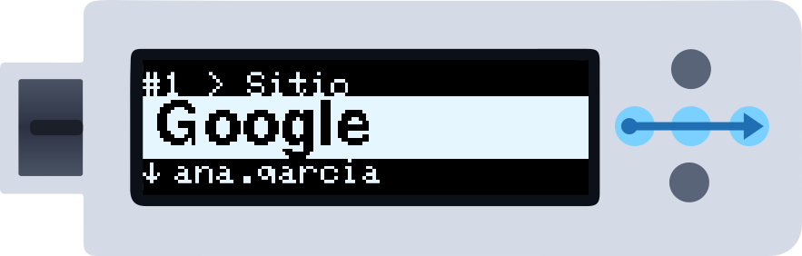
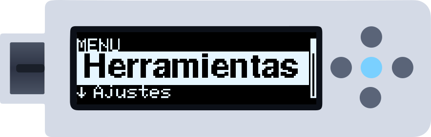
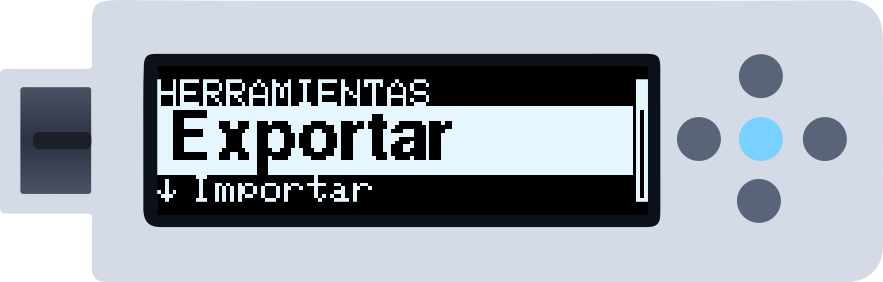
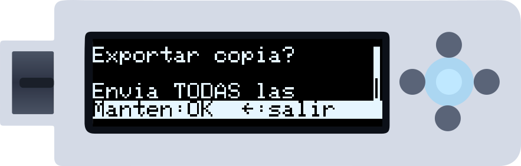
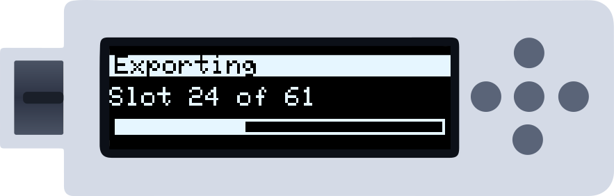
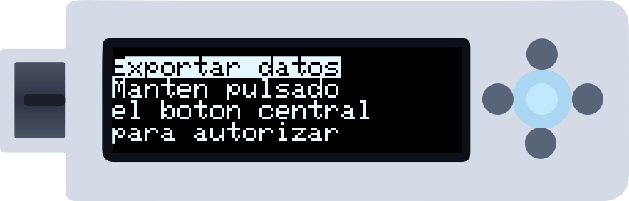

Una copia de seguridad te protege contra pérdida o daño del dispositivo. ZeroKeyUSB hace que el proceso sea **deliberado**: ninguna credencial sale del dispositivo sin que mantengas el punto central para autorizarlo.

<Warning>
La copia de seguridad sale en **texto plano** por USB serie. Cífrala inmediatamente después de guardarla (GPG, age, 7z con contraseña…) y guárdala offline.
</Warning>

---

## Antes de empezar

| Necesitas | Para qué |
|-----------|----------|
| El dispositivo desbloqueado | Solo se puede exportar con el PIN ya introducido |
| Una herramienta serie | Web manager, `screen`, `minicom`, PuTTY o similar a 115200 bps |
| Un sitio seguro donde guardar el fichero | Disco cifrado, tarjeta SD bajo llave, etc. |

---

Hay dos formas de empezar una exportación. Las dos terminan con que **mantienes el centro** en el dispositivo: nada sale de él sin eso.

- **Desde el web manager** (lo más sencillo): pide la exportación al dispositivo y este te pide que la autorices; ver [desde el web manager](#desde-el-web-manager) más abajo.
- **Desde el menú del dispositivo**: Herramientas → Exportar, como en los pasos siguientes. Ten ya conectada y escuchando tu herramienta serie, porque los datos salen enseguida.

En las ilustraciones una **flecha azul** es un deslizamiento, el **punto central iluminado** un toque y un **halo** mantenerlo; en modo Botones pulsa el punto que va entre paréntesis.

## Paso 1 — Abrir el menú

Desde la cuenta 1, desliza **de izquierda a derecha** (Izquierda): el menú entra por la izquierda. Ver [Navegar por el menú](/es/getting-started/menu-navigation) si tienes dudas.



---

## Paso 2 — Herramientas

**Herramientas** es la primera opción del menú. Toca el centro (Centro) para abrirla.



---

## Paso 3 — Exportar

**Exportar** es la primera opción de Herramientas. Toca el centro.



---

## Paso 4 — Confirmar manteniendo

Una página de confirmación te recuerda que se enviarán **todas** las credenciales al ordenador en claro. Solo sigue si **mantienes el centro unos 1,5 segundos**: mientras mantienes, un borde se llena alrededor de la pantalla. Un toque no hace nada; deslizar de izquierda a derecha (Izquierda) cancela.



---

## Paso 5 — Envío

El dispositivo lee cada hueco y lo envía como una línea CSV por USB, mostrando el progreso. No tienes que hacer nada.



*Recorre los 61 huecos y vuelve al menú.*

---

## Desde el web manager

Cuando el [web manager](https://zerokeyusb.com/manager) empieza una exportación, el dispositivo muestra:



*Mantén el centro alrededor de un segundo para autorizarla (Botones: mantén Centro). El dispositivo indica que está enviando y, al terminar, "Exportacion lista".*

---

## Paso 6 — Capturar el CSV en el host

Mientras el dispositivo envía, en tu terminal serie verás aparecer línea a línea:

```csv
61
0,Google,user1,contrasena1,JBSWY3DPEHPK3PXP
1,Apple,user2,password,
2,Netflix,user3,Atalaya,
3,github,user4,no me acuerdo,JBSWY3DPEHPK3PXP;algo=SHA256
4,Amazon,comprador99,123456,
...
```

| Campo | Significado |
|-------|-------------|
| Línea 0 | Número total de huecos (siempre `61`) |
| `slotIndex` | 0–60 |
| `site` | Sitio (≤32 chars) |
| `username` | Usuario (≤32 chars) |
| `password` | Contraseña |
| `totpSecret` | Opcional — Base32 (con `;algo=SHA256` opcional) o vacío |

Guarda el output completo en un fichero (`zerokeyusb-2026-05-27.csv`, por ejemplo). En el web manager hay un botón "Guardar" que hace esto por ti.

---

## Paso 7 — Cifrar inmediatamente

<Warning>
El CSV recién guardado contiene **todas** tus contraseñas en claro. Cífralo nada más capturarlo y borra la versión sin cifrar.
</Warning>

```bash
# Opción A: GPG (simétrico, AES-256)
gpg -c --cipher-algo AES256 zerokeyusb-2026-05-27.csv
shred -u zerokeyusb-2026-05-27.csv

# Opción B: age con contraseña
age -p -o zerokeyusb-2026-05-27.csv.age zerokeyusb-2026-05-27.csv
shred -u zerokeyusb-2026-05-27.csv

# Opción C: 7z con contraseña fuerte (Windows)
7z a -p -mhe=on zerokeyusb-2026-05-27.7z zerokeyusb-2026-05-27.csv
del zerokeyusb-2026-05-27.csv
```

---

## ¿Cuándo hacer copia?

| Cuándo | Por qué |
|--------|---------|
| Tras añadir o importar varias credenciales | Para no perder el trabajo nuevo |
| Antes de hacer Reset de fábrica o flashear firmware | El reset es irreversible |
| Antes de cualquier acción de la **Zona crítica** | Idem |
| Periódicamente | Como parte de tu rutina de seguridad |

---

## Buenas prácticas

| Práctica | Por qué |
|----------|---------|
| Cifra al instante | El CSV en plano es un riesgo enorme |
| Guarda en ≥ 2 lugares físicos distintos | Protege contra fallo de un disco/nube |
| Prueba la restauración alguna vez | Garantiza que el fichero es válido cuando lo necesites |
| Borra copias antiguas con `shred` | Reduce la exposición |
| Nombra con fecha (`YYYY-MM-DD`) | Para saber cuál es la más reciente |

---

## Próximos pasos

<CardGroup cols={2}>
  <Card title="Importar credenciales" icon="cloud-arrow-up" href="/es/getting-started/importing-credentials">
    Restaurar desde una copia o migrar de otro gestor.
  </Card>
  <Card title="Navegar el menú" icon="bars" href="/es/getting-started/menu-navigation">
    Conoce el resto de opciones del menú.
  </Card>
</CardGroup>
