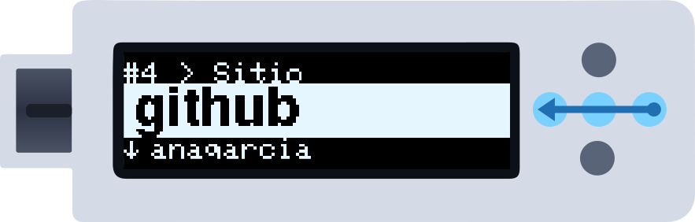
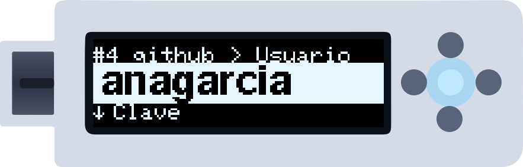
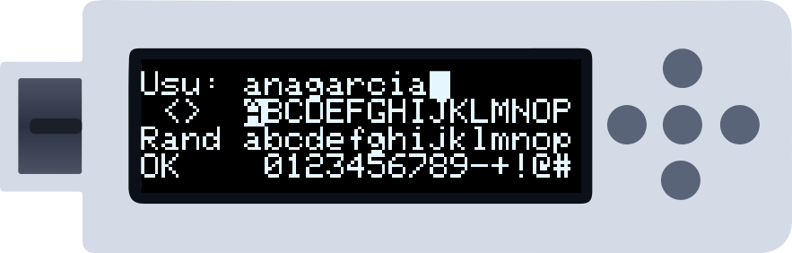
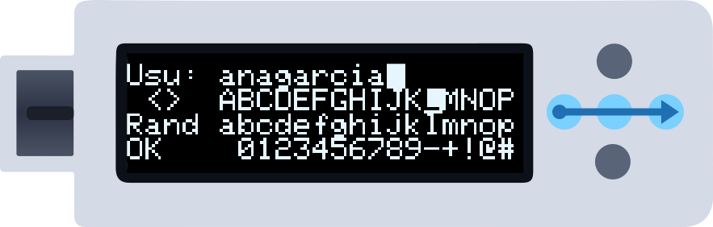
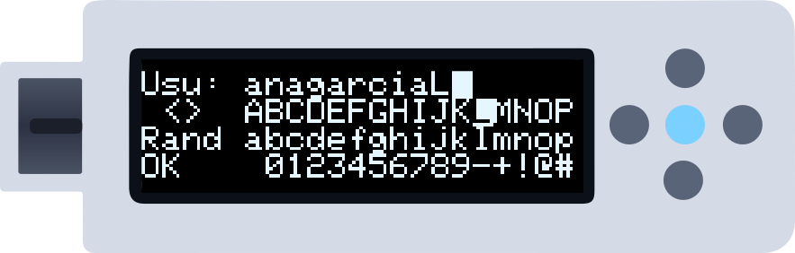
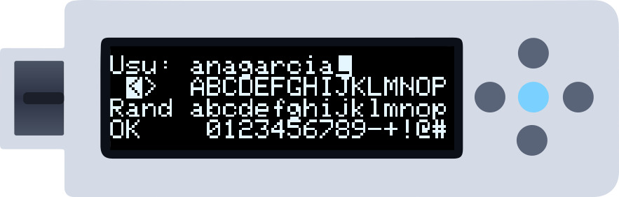
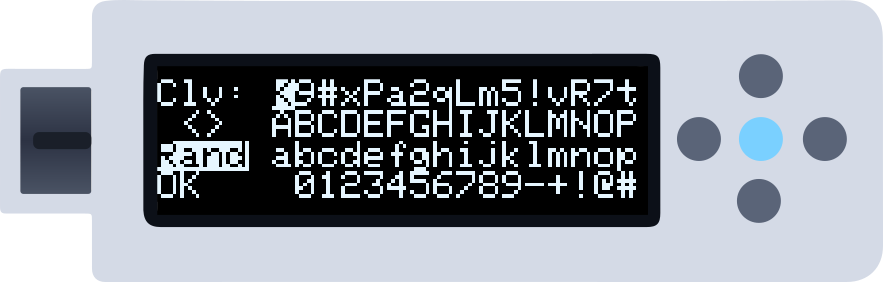
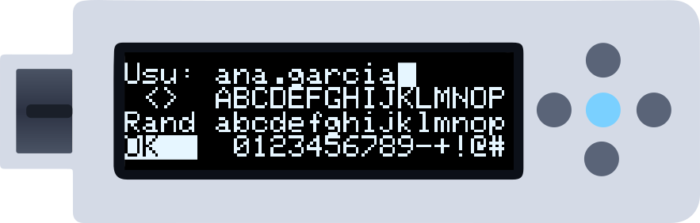

Esta guía detalla todas las operaciones del editor del dispositivo. Si solo quieres crear tu primera credencial, empieza por [Crea tu primera credencial](/es/getting-started/first-credential). En las ilustraciones una **flecha azul** es un deslizamiento, el **punto central iluminado** un toque y un **halo** mantenerlo; en modo Botones pulsa el punto que va entre paréntesis.

---

## Paso 1 — Busca la cuenta

En tus cuentas, desliza **de derecha a izquierda** (Derecha) para la siguiente y **de izquierda a derecha** (Izquierda) para la anterior. Para ir más rápido, deja el dedo en el último punto tras deslizar: salta de 10 en 10.

*La fila de arriba muestra el número de cuenta (`#4`) y el campo en el que estás.*

<Tip>
Con muchas cuentas, desliza **hacia abajo** (Arriba) en el campo sitio para abrir la búsqueda alfabética.
</Tip>

---

## Paso 2 — Elige el campo y abre el editor

Desliza **hacia arriba** (Abajo) para pasar de **Sitio** a **Usuario**, **Clave** y **2FA** (si la cuenta tiene); **hacia abajo** (Arriba) para volver. En el campo que quieras, **mantén el centro** alrededor de un segundo.

*Un borde se llena alrededor de la pantalla; cuando se cierra, levanta el dedo y se abre el editor. Un toque **corto** escribiría el campo en el ordenador.*

---

## Paso 3 — Anatomía del editor

| Elemento | Función |
|----------|---------|
| Fila 1 | El campo (**hasta 32 caracteres**; se desplaza a partir de 16) con el cursor, invertido, donde irá el siguiente carácter |
| Fila 2 — `<` `>` | Mueven ese cursor una posición a la izquierda o a la derecha |
| Fila 2 — teclado | Mayúsculas `A`–`Z` y `( ) [ ] { }` |
| Fila 3 — `Rand` | Rellena el campo con un valor aleatorio fuerte (formato en **Ajustes → Pwd**) |
| Fila 3 — teclado | Minúsculas `a`–`z` y `< > | \ / ?` |
| Fila 4 — `OK` | Guarda y vuelve a la cuenta |
| Fila 4 — teclado | Espacio, `0`–`9` y símbolos |

Cada fila del teclado muestra 16 teclas a la vez y se desplaza cuando pasas del borde.

---

## Paso 4 — Moverse por el teclado

En el editor la selección **sigue al dedo**: desliza a la derecha o a la izquierda para moverte por una fila, arriba o abajo para cambiar de fila.

*Deja el dedo en el último punto tras un deslizamiento lateral y la selección sigue avanzando. Antes de la primera tecla de una fila están los controles de su izquierda (`<` `>`, `Rand`, `OK`).*

---

## Paso 5 — Insertar un carácter

Con el carácter elegido, **toca el centro**. Se escribe en el cursor, que avanza una posición.

---

## Paso 6 — Mover el cursor del campo

Para cambiar un carácter en mitad del campo, ve a `<` o `>` (fila 2, a la izquierda) y toca el centro: el cursor se mueve una posición. Después vuelve a una fila del teclado e inserta el carácter nuevo.

<Tip>
Los caracteres **sobrescriben** lo que hay bajo el cursor; no empujan el texto. Para "borrar" uno, pon un espacio encima (la primera tecla de la fila de números).
</Tip>

---

## Paso 7 — Generar una contraseña aleatoria

En vez de escribir una contraseña, ve a **Rand** y toca el centro. El campo se llena con un valor aleatorio fuerte de **hasta 32 caracteres**, en el formato elegido en **Menú → Ajustes → Pwd**:

| Ajuste | Formato | Ejemplo |
|--------|---------|---------|
| `Symbols` (por defecto) | Todo el juego imprimible (letras, cifras, símbolos) | `t7#Kp!2r$Qm9^Za5Wd8&Bv3Ln6@Xj1Qz` |
| `Numeric` | Cifras | `48201937560428173905641820937584` |
| `a-z 0-9` | Minúsculas y cifras | `k3m9xq1z7r4p2n8wj5c6vb0hd1ft9gs2` |
| `Aa-z 0-9` | Mayúsculas, minúsculas y cifras | `Kp3Mx9Qz1Rt4Nb8yWd2Fc7Hj5Lv0Gs6R` |
| `Words` | Palabras unidas por un separador aleatorio | `Ocean-Cargo-Mint-River-Sun` |
| `Words+Num` | Lo mismo, con un grupo de 2 cifras | `River_28_Mango_Ocean_Tiger` |

`Rand` en el campo **sitio** o **usuario** usa siempre `Symbols`.

*¿No te convence? Toca el centro otra vez y sale otra.*

---

## Paso 8 — Guardar

Ve a **OK** (fila 4, a la izquierda) y toca el centro. Los cambios se cifran y se guardan, y vuelves a la cuenta.

<Warning>
Salir del editor de cualquier otra forma que no sea **OK** descarta los cambios. No hay confirmación.
</Warning>

---

## Referencia rápida

| Acción | Gestos | Botones |
|--------|--------|---------|
| Abrir el editor | Mantener el centro en un campo | Mantener Centro |
| Moverse por una fila | Deslizar izquierda / derecha (deja el dedo para repetir) | Izquierda / Derecha |
| Cambiar de fila | Deslizar arriba / abajo | Arriba / Abajo |
| Insertar el carácter | Tocar el centro | Centro |
| Mover el cursor del campo | Tocar el centro en `<` o `>` | Centro en `<` / `>` |
| "Borrar" un carácter | Poner un espacio encima | Igual |
| Valor aleatorio | Tocar el centro en `Rand` | Centro en `Rand` |
| Guardar y salir | Tocar el centro en `OK` | Centro en `OK` |

---

## Siguientes pasos

<CardGroup cols={2}>
  <Card title="Configurar 2FA" icon="clock" href="/es/getting-started/totp-codes">
    Los secretos 2FA se cargan desde el ordenador, no se teclean en el dispositivo.
  </Card>
  <Card title="Hacer una copia" icon="cloud-arrow-down" href="/es/getting-started/creating-backups">
    Guarda tu estado actual antes de editar muchas credenciales.
  </Card>
</CardGroup>
