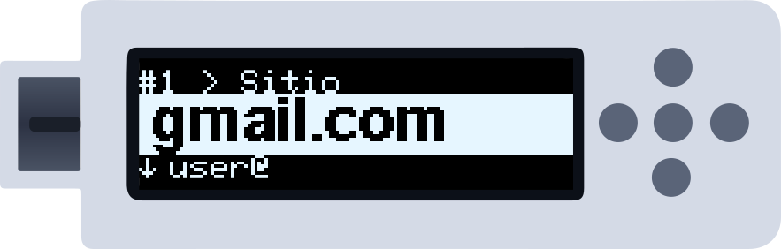
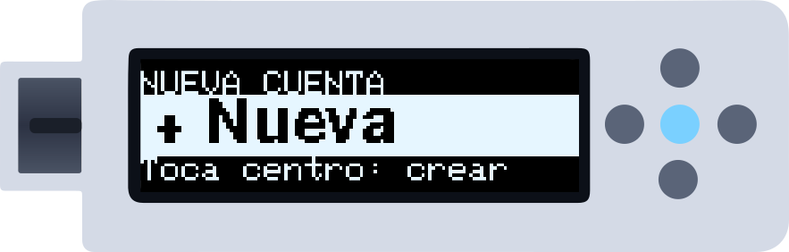
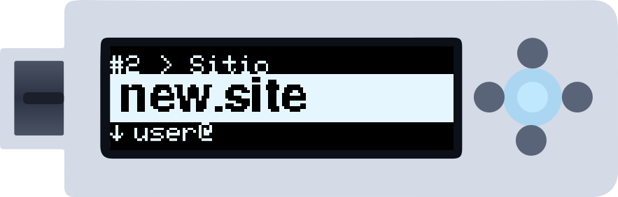
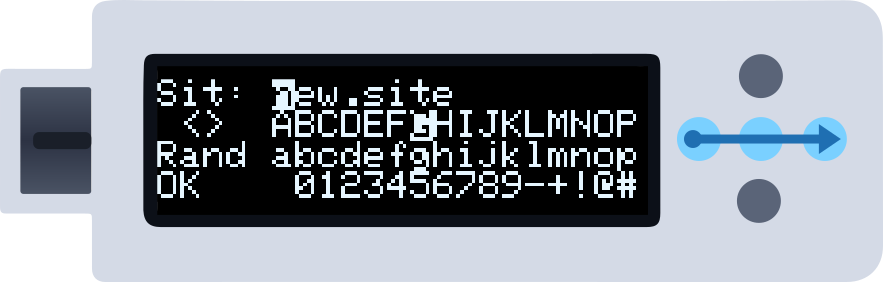
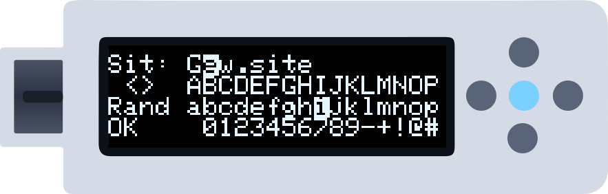
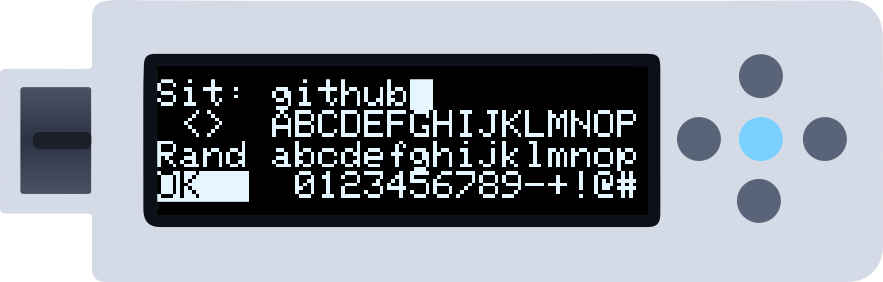
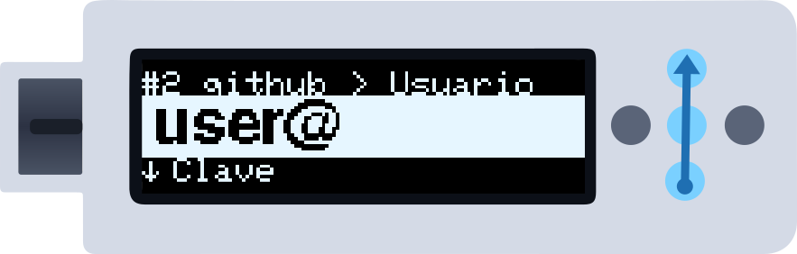
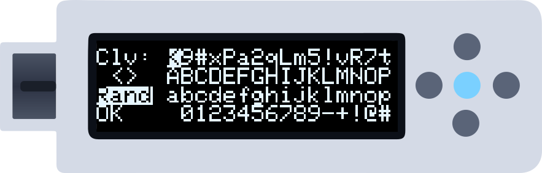
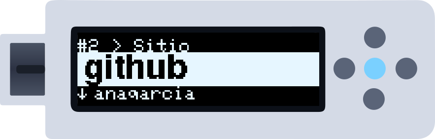

Esta guía asume que ya has completado la [configuración inicial](/es/getting-started/setup-wizard). Las ilustraciones muestran el movimiento que hay que hacer en los puntos dorados: una **flecha azul** es un deslizamiento (empieza donde está la cola de la flecha), el **punto central iluminado** es un toque y el **punto central con halo** significa mantenerlo. En modo Botones, pulsa el punto que va entre paréntesis. Ver [Gestos](/es/getting-started/gestures).

---

## Paso 1 — Desbloquear con el PIN

Al conectar el dispositivo aparece la rueda del PIN. Para cada cifra: desliza **arriba o abajo** para girar la rueda hasta el número y luego **de derecha a izquierda** para añadirlo (Botones: **Arriba/Abajo** y después **Derecha**).

*Tras cada número la rueda se para en el ✓. Cuando hayas metido la última cifra, desliza una vez más de derecha a izquierda sobre el ✓ para desbloquear. Deslizar de izquierda a derecha borra el último número.*

---

## Paso 2 — La cuenta de ejemplo

En un equipo nuevo la lista no está vacía: la cuenta 1 es un ejemplo, `gmail.com` con usuario `user@` y clave `password1234`, para que puedas probar a escribir enseguida. Puedes editarla o sobrescribirla como cualquier otra.

---

## Paso 3 — "+ Nueva"

Después de tu última cuenta viene **+ Nueva**. Desde la cuenta 1, desliza **de derecha a izquierda** (Derecha) una vez por cuenta hasta que aparezca. Luego **toca el centro** (Centro).

---

## Paso 4 — La cuenta nueva

El dispositivo rellena el primer hueco libre con valores provisionales (`new.site` / `user@` / `pass`) y te la muestra. La fila de arriba te dice dónde estás: `#2 > Sitio`.

*Para cambiar el sitio, **mantén el centro** alrededor de un segundo (Botones: mantén Centro). Un borde se llena alrededor de la pantalla; cuando se cierra, levanta el dedo y se abre el editor. Un toque corto, en cambio, **escribiría** el campo en tu ordenador.*

---

## Paso 5 — El editor

El editor ocupa la pantalla con cuatro filas:

1. **Arriba:** el campo que editas, con el cursor (invertido) donde irá el siguiente carácter.
2. **Fila 2:** `<` `>` para mover ese cursor + el teclado de **mayúsculas**.
3. **Fila 3:** `Rand` (relleno aleatorio) + el teclado de **minúsculas**.
4. **Fila 4:** `OK` (guardar) + **números y símbolos**.

En el editor la selección **sigue al dedo**: desliza a la derecha para avanzar por una fila y hacia abajo para pasar a la fila de abajo. **Toca el centro** para insertar el carácter elegido.

*Desliza a la derecha (Derecha) por la fila de mayúsculas hasta la `G` y toca el centro: la `G` sustituye a la primera letra y el cursor avanza.*

<Tip>
Deja el dedo en el último punto tras un deslizamiento lateral y la selección sigue avanzando por la fila.
</Tip>

---

## Paso 6 — Minúsculas, números y símbolos

Desliza **hacia abajo** (Abajo) para pasar de las mayúsculas a las minúsculas, y otra vez para números y símbolos. Desliza **hacia arriba** (Arriba) para volver.

*Inserta el resto de letras tocando el centro.*

<Tip>
Los caracteres **sobrescriben** lo que hay bajo el cursor; no empujan el texto. Para borrar las letras que sobran de `new.site`, pon un espacio (la primera tecla de la fila de números) encima de cada una.
</Tip>

---

## Paso 7 — Guardar

Cuando el campo esté como quieres, ve a **OK** (fila 4, a la izquierda): desliza hacia abajo desde `Rand`, o a la izquierda desde el principio de la fila de números. Luego **toca el centro**.

*El campo se cifra y se guarda, y vuelves a la cuenta.*

---

## Paso 8 — El campo usuario

De vuelta en la cuenta, desliza **hacia arriba** (Abajo) para pasar del sitio al **usuario**: el campo nuevo sube desde abajo y la fila de arriba dice ahora `#2 github > Usuario`.

*Mantén el centro para editarlo, igual que hiciste con el sitio.*

---

## Paso 9 — Una contraseña aleatoria con Rand

Desliza otra vez hacia arriba para llegar a la **clave** y abre el editor. En vez de escribirla, ve a **Rand** y toca el centro: el campo se llena con una contraseña fuerte y aleatoria, en el formato elegido en **Menú → Ajustes → Pwd**.

*¿No te convence? Toca otra vez y sale otra. Después ve a **OK** y toca el centro.*

---

## Paso 10 — Hecho

La cuenta está guardada. En el campo **sitio**, un toque en el centro escribe `usuario` + `TAB` + `clave` + `ENTER` en tu ordenador, como si lo tecleases tú. En el campo usuario o clave, un toque escribe solo ese campo.

*Pon el cursor en la casilla de usuario del formulario de acceso y toca el centro.*

---

## Siguientes pasos

<CardGroup cols={2}>
  <Card title="Editar una credencial" icon="pen-to-square" href="/es/getting-started/edit-credential">
    Todas las operaciones del editor en detalle.
  </Card>
  <Card title="Configurar 2FA" icon="clock" href="/es/getting-started/totp-codes">
    Usa códigos TOTP para accesos con doble factor.
  </Card>
  <Card title="Hacer una copia" icon="cloud-arrow-down" href="/es/getting-started/creating-backups">
    Exporta tus credenciales a un fichero seguro.
  </Card>
  <Card title="Gestos" icon="hand-pointer" href="/es/getting-started/gestures">
    Todos los movimientos, en todas las pantallas.
  </Card>
</CardGroup>
