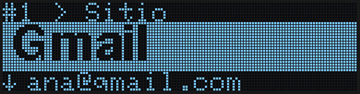
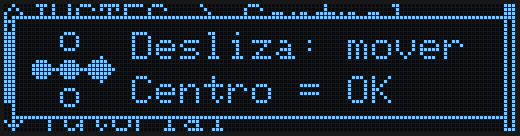
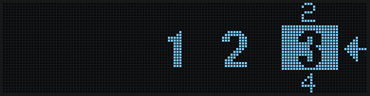
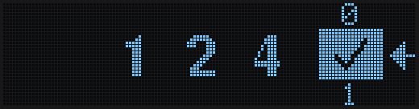
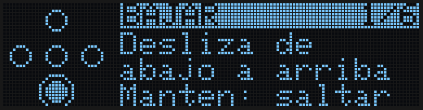
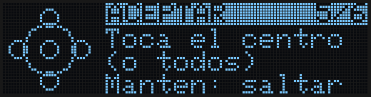
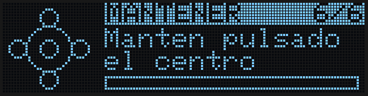
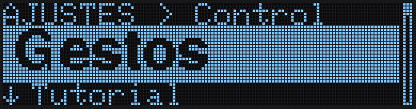

Desde el firmware **1.1.0**, ZeroKeyUSB se maneja **deslizando** el dedo por los puntos dorados en lugar de pulsarlos uno a uno. Ya no hace falta acertar en un punto pequeño: lo que cuenta es hacia dónde va el dedo. Si prefieres la forma clásica, puedes volver a pulsar los puntos en **Menú → Ajustes → Control** (ver [Botones o Gestos](#botones-o-gestos)).

<Tip>
Puedes probar todos los movimientos en el [simulador online](https://zerokeyusb.com/simulador.html) antes de usar el dispositivo: arrastra el ratón (o el dedo) por los puntos.
</Tip>

---

## Todas las pantallas son iguales

Todas las pantallas tienen las mismas tres partes; si conoces una, las conoces todas:

| Parte | Dónde | Qué te dice |
|-------|-------|-------------|
| **Dónde estás** | Fila de arriba, pequeña | La cuenta, el menú o el paso en el que estás (`#3 Gmail > Usuario`, `AJUSTES > Mano`, `2/7 MANO`) |
| **Lo importante** | La banda grande iluminada | El valor sobre el que puedes actuar: el sitio, el usuario, la opción… |
| **Lo que viene** | Fila de abajo (y borde derecho) | Lo que hay debajo (`↓ Clave`), o una flecha animada con el movimiento que toca |

---

## Los movimientos

| Movimiento | Qué hace, en todas las pantallas |
|------------|----------------------------------|
| **Deslizar de derecha a izquierda** | **Avanzar**: cuenta siguiente, paso siguiente, del menú a tus cuentas |
| **Deslizar de izquierda a derecha** | **Volver**: cuenta anterior, paso anterior, salir de un submenú. Desde la cuenta 1 abre el menú |
| **Deslizar arriba o abajo** | **Cambiar lo que hay en la banda**: el campo, la opción o el valor siguiente o anterior |
| **Tocar el centro** | **Actuar** sobre lo que hay en la banda: escribirlo en el ordenador, abrir el submenú, aplicar el ajuste |
| **Mantener el centro** | La acción fuerte: editar el campo; confirmar algo irreversible |

Piensa que arrastras la pantalla, como en un móvil: al deslizar de derecha a izquierda, la cuenta siguiente entra por la derecha. En las pocas pantallas con cursor (el editor del dispositivo, la fecha y hora del 2FA, la búsqueda) el cursor simplemente sigue al dedo.

Un deslizamiento **pasa por el punto central**: de un punto del borde, por el centro, al punto del borde contrario. Los toques también son tolerantes: tocar el centro junto con un vecino, o los cinco puntos a la vez, cuenta como toque en el centro.

### Nada cambia sin moverse

Lo que cambia se desliza en la dirección del dedo: el campo siguiente sube desde abajo, la cuenta siguiente entra por la derecha. Solo se mueve lo que cambia; la fila de arriba se queda quieta.

### Deja el dedo apoyado

- En las listas (el menú, la rueda del PIN), desliza y **deja el dedo en el último punto** para seguir avanzando.
- En tus cuentas, desliza de lado y deja el dedo apoyado para **saltar 10 cuentas** de golpe.

### ¿Has tocado un solo punto del borde?

Tocar solo un punto del borde no hace nada; sería demasiado fácil hacerlo sin querer. En su lugar aparece un dibujo con el deslizamiento que hace lo que querías.

---

## Meter el PIN

La pantalla del PIN sigue las mismas reglas. A la derecha hay una **rueda**: el número elegido va iluminado, con el anterior encima y el siguiente debajo. Los números que ya has metido están a su izquierda.

| Movimiento | Qué hace |
|------------|----------|
| **Deslizar arriba o abajo** | Gira la rueda: el número rueda hacia donde va el dedo |
| **Deslizar de derecha a izquierda** | Mete el número elegido en la fila, que corre a la izquierda para hacerle sitio |
| **Deslizar de izquierda a derecha** | Devuelve el último número a la rueda, listo para corregirlo |
| **De derecha a izquierda sobre ✓** | Tras cada número la rueda se para en el ✓. El mismo deslizamiento confirma el PIN |

| Añadir un número | Borrar el último |
|---|---|
|  |  |

En la pantalla del PIN un toque no hace nada, así que el PIN nunca se confirma sin querer.

---

## El tutorial

La primera vez que configuras el dispositivo, un tutorial animado y breve enseña cada movimiento: lo muestra, espera a que lo hagas y dice **Bien!** cuando aciertas. Mantén el centro para saltar una lección. Puedes repetirlo cuando quieras desde **Menú → Ajustes → Tutorial**.

| Lección | Tocar | Mantener |
|---|---|---|
|  |  |  |

---

## Botones o Gestos

**Menú → Ajustes → Control** cambia entre:

- **Gestos** (predeterminado): todo lo que explica esta página.
- **Botones**: la forma clásica; cada punto es un botón que se pulsa (Arriba, Abajo, Izquierda, Derecha, Centro). Las pantallas y los menús son los mismos; en el PIN la flecha apunta al punto Derecha, que es el que añade el número.

Al cambiar a Gestos se abre el tutorial. Para volver, abre la misma opción y toca el centro: funciona en los dos modos.

 Control" />

---

## Diestro o zurdo

**Menú → Ajustes → Mano** da la vuelta a la pantalla para que puedas sujetar el dispositivo con los puntos a cualquier lado (Diestro es el predeterminado). Los movimientos no cambian para tu dedo: "arriba" es siempre hacia la parte de arriba de la pantalla tal como la lees.

---

## Siguientes pasos

<CardGroup cols={2}>
  <Card title="Configuración inicial" icon="wand-magic-sparkles" href="/es/getting-started/setup-wizard">
    Los 7 pasos que ves la primera vez que conectas el dispositivo.
  </Card>
  <Card title="Navegar por el menú" icon="bars" href="/es/getting-started/menu-navigation">
    Herramientas, Ajustes, Zona crítica e Info.
  </Card>
  <Card title="Cómo funciona el táctil" icon="microchip" href="/es/firmware/io-touch-handling">
    Detalle técnico: cómo se reconocen los deslizamientos (sección Software).
  </Card>
</CardGroup>
