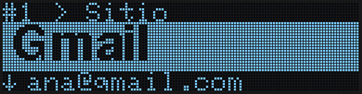
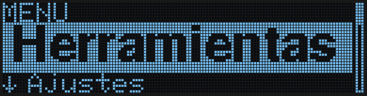
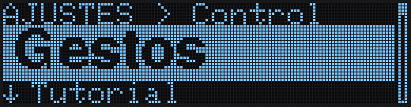
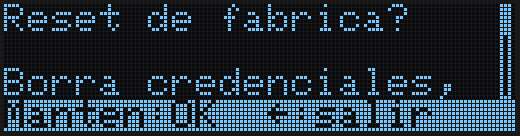
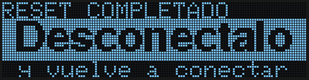

El menú principal reúne todo lo que **no** es una cuenta: herramientas (copias de seguridad, el monedero Bitcoin, el enlace con el navegador), ajustes, las opciones peligrosas (reset de fábrica) e información del dispositivo. Esta guía explica cómo llegar y cómo moverte dentro.

Los movimientos son los de siempre (ver [Gestos](/es/getting-started/gestures)). En modo **Botones**, usa el punto que va entre paréntesis.

---

## Llegar al menú

Tus cuentas y el menú están en una misma tira: el menú queda a la izquierda de la cuenta 1, y **+ Nueva** después de tu última cuenta.

- Desde la **cuenta 1**, desliza **de izquierda a derecha** (Izquierda). El menú entra por la izquierda.
- Desde **+ Nueva**, desliza **de derecha a izquierda** (Derecha).

<Tip>
Para recorrer muchas cuentas rápido, desliza de lado y **deja el dedo en el último punto**: salta de 10 en 10 (en modo Botones, mantén Izquierda o Derecha).
</Tip>

---

## La pantalla del menú

El menú es como cualquier otra pantalla: arriba, en pequeño, dónde estás; en la banda, en grande, la opción elegida; debajo, la siguiente (`↓ …`); y a la derecha, una barra con tu posición en la lista.

| Opción | Qué contiene |
|--------|--------------|
| **Herramientas** | Exportar e Importar credenciales por USB, el monedero **Bitcoin** y el enlace con el navegador (**Chrome: On/Off**) |
| **Ajustes** | Control, Tutorial, Mano, Teclado, Idioma, lector de pantalla, formato de contraseña |
| **Zona crítica** | Reset de fábrica y modo bootloader |
| **Info** | Versión del firmware, número de serie, huecos libres y fecha de compilación |

| Movimiento | Qué hace |
|------------|----------|
| Deslizar arriba o abajo (Arriba / Abajo) | Opción anterior o siguiente |
| Tocar el centro (Centro) | Abrir el submenú o ejecutar la opción |
| Deslizar de izquierda a derecha (Izquierda) | Volver al menú anterior; desde el menú principal, a tus cuentas (**+ Nueva**) |
| Deslizar de derecha a izquierda (Derecha) | Salir a la cuenta 1, desde cualquier menú |

---

## Ajustes

Cada opción muestra su valor actual. Toca el centro para cambiarlo; un aviso breve confirma el valor nuevo.

| Opción | Qué hace |
|--------|----------|
| **Control: Gestos / Botones** | Deslizar por los puntos o pulsarlos uno a uno. Al cambiar a Gestos se abre el tutorial |
| **Tutorial** | Repite el tutorial animado |
| **Mano: Diestro / Zurdo** | Da la vuelta a la pantalla (Diestro es el predeterminado) |
| **Teclado: XX-XX** | La distribución del teclado de tu ordenador, para que los símbolos salgan bien |
| **Idioma: Espanol / English** | El idioma del dispositivo |
| **Reader: On/Off** | Mantiene el [modo lector de pantalla](/es/getting-started/recovery-no-screen) activo entre reinicios |
| **Pwd: …** | El formato de las contraseñas aleatorias (Symbols, Numeric, a-z 0-9, Aa-z 0-9, Words, Words+Num) |

---

## Herramientas

| Opción | Qué hace |
|--------|----------|
| Exportar | Envía todas tus credenciales al ordenador por USB (ver [Crear una copia](/es/getting-started/creating-backups)) |
| Importar | Recibe credenciales desde el ordenador (ver [Importar credenciales](/es/getting-started/importing-credentials)) |
| Bitcoin | El monedero Bitcoin: crearlo, ver la semilla, exportar solo lectura, firmar transacciones (ver [Monedero Bitcoin](/es/getting-started/bitcoin)) |
| Chrome: On/Off | Permite que la [extensión del navegador](/es/getting-started/browser-extension) encuentre la cuenta correcta |

---

## Zona crítica

<Warning>
Estas acciones no se pueden deshacer. Piden confirmación **manteniendo el centro** (unos 1,5 s): un toque no hace nada, y deslizar de izquierda a derecha cancela. Mientras mantienes, un borde se va llenando alrededor de la pantalla.
</Warning>

| Opción | Qué hace |
|--------|----------|
| Reset de fábrica | Borra **todas** las credenciales, el PIN y la configuración. Al terminar, la pantalla te pide que desconectes el dispositivo, y no hace nada más hasta que lo hagas. Al volver a conectarlo empieza la [configuración inicial](/es/getting-started/setup-wizard) |
| Modo bootloader | Reinicia el dispositivo listo para recibir una actualización de firmware |

---

## Info

Muestra la versión del firmware (`SW: 1.1.0`), el número de serie del dispositivo, los identificadores del microcontrolador y del chip de seguridad, cuántos de los 61 huecos están usados y la fecha de compilación. Es solo de lectura.

---

## Siguientes pasos

<CardGroup cols={2}>
  <Card title="Gestos" icon="hand-pointer" href="/es/getting-started/gestures">
    Todos los movimientos, en todas las pantallas.
  </Card>
  <Card title="Monedero Bitcoin" icon="bitcoin-sign" href="/es/getting-started/bitcoin">
    Crea un monedero, exporta solo lectura y firma transacciones.
  </Card>
  <Card title="Crear una copia" icon="cloud-arrow-down" href="/es/getting-started/creating-backups">
    Primer uso de Herramientas → Exportar.
  </Card>
  <Card title="Pantalla rota o sin pantalla" icon="eye-low-vision" href="/es/getting-started/recovery-no-screen">
    Lee la pantalla por USB si el display falla.
  </Card>
</CardGroup>
