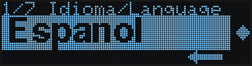
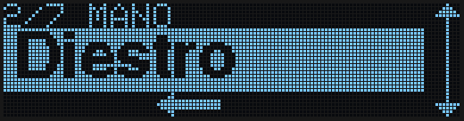
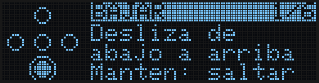
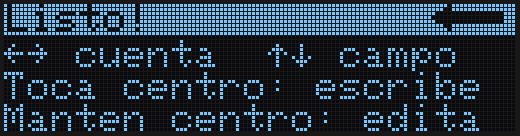
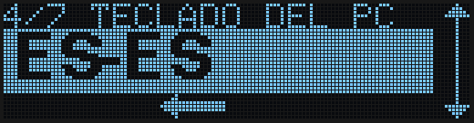
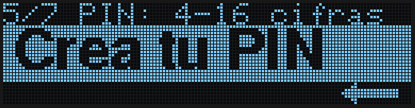
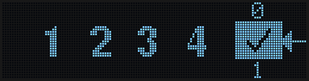
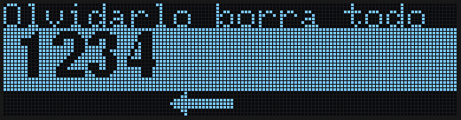
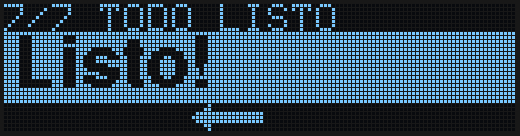
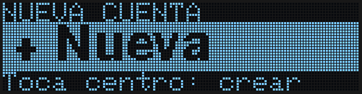

La primera vez que conectas tu ZeroKeyUSB a un puerto USB-C (y después de un reset de fábrica), empieza sola una configuración breve. Tiene **7 pasos** y todos funcionan igual, con [gestos](/es/getting-started/gestures):

- **Desliza arriba o abajo** para cambiar el valor de la banda grande.
- **Desliza de derecha a izquierda** para pasar al paso siguiente.
- **Desliza de izquierda a derecha** para volver.

Nunca se avanza tocando, así que un toque sin querer no se salta ningún paso. Las flechas animadas de cada pantalla muestran el movimiento: la que se desliza por abajo dice "desliza así para seguir"; la doble flecha que crece en el borde derecho dice "desliza arriba o abajo para cambiar".

<Note>
Esta página describe el firmware **1.1.0**. La configuración usa siempre gestos; si prefieres pulsar los puntos uno a uno, cámbialo después en **Menú → Ajustes → Control**.
</Note>

---

## Paso 1 — Idioma

Elige **Español** o **English** deslizando arriba o abajo. El título sale en los dos idiomas porque aún no has elegido.

*Desliza arriba o abajo para cambiar y de derecha a izquierda para seguir.*

---

## Paso 2 — Mano

Elige **Diestro** o **Zurdo**. La pantalla gira en el momento, así ves qué te resulta cómodo antes de seguir.

*Desliza arriba o abajo para cambiar y de derecha a izquierda para seguir.*

---

## Paso 3 — Tutorial

Un tutorial animado y breve enseña los movimientos de uno en uno: deslizar hacia arriba, abajo, izquierda y derecha, tocar el centro y mantenerlo. Cada lección muestra el movimiento y espera a que lo hagas; cuando aciertas dice **Bien!**. Mantener el centro salta la lección.

La última tarjeta resume cómo usar tus cuentas. Desliza de derecha a izquierda para cerrarla.

<Tip>Puedes repetir el tutorial cuando quieras desde **Menú → Ajustes → Tutorial**.</Tip>

---

## Paso 4 — Teclado del PC

ZeroKeyUSB escribe tus contraseñas como si fuera un teclado USB. Para que símbolos como `@`, `!` o `#` salgan bien, necesita saber la distribución del teclado de **tu ordenador**.

*Desliza arriba o abajo para pasar por EN-US, DA-DK, DE-DE, ES-ES, FR-FR, HU-HU, IT-IT, PT-PT y SV-SE. Cuando salga el tuyo, desliza de derecha a izquierda.*

<Tip>Puedes cambiarlo después en **Menú → Ajustes → Teclado**.</Tip>

---

## Paso 5 — Crea tu PIN

Tu PIN maestro tiene **de 4 a 16 cifras**. Es lo único que desbloquea el dispositivo.

*Desliza de derecha a izquierda para abrir la rueda del PIN.*

En la rueda:

| Movimiento | Qué hace |
|------------|----------|
| Deslizar arriba o abajo | Gira la rueda hasta el número que quieres |
| Deslizar de derecha a izquierda | Añade el número a tu PIN |
| Deslizar de izquierda a derecha | Borra el último número (si no hay ninguno, vuelve a la tarjeta anterior) |
| De derecha a izquierda sobre **✓** | Guarda el PIN; tras cada número la rueda se para en el ✓ |

| Añadir un número | Guardar en el ✓ |
|---|---|
|  |  |

<Warning>
**El PIN no se puede recuperar.** Si lo olvidas, la única salida es un reset de fábrica, que borra **todas** tus credenciales.
</Warning>

---

## Paso 6 — PIN guardado

El dispositivo te enseña el PIN que acabas de crear, en grande, **una sola vez**, para que lo compruebes. La fila de arriba te lo recuerda: olvidarlo lo borra todo.

*Memorízalo y desliza de derecha a izquierda.*

---

## Paso 7 — Listo

*Desliza de derecha a izquierda. Aparece la pantalla del PIN: mete el PIN que acabas de crear, de la misma forma, y llegarás a tus cuentas. Como aún no tienes ninguna, la primera pantalla es **+ Nueva**.*

*Toca el centro para crear tu primera credencial: ver [Crea tu primera credencial](/es/getting-started/first-credential).*

<Note>
A partir de ahora, cada vez que conectes el dispositivo te pedirá el PIN. Un PIN equivocado solo te hace esperar antes de volver a intentarlo (5 s, luego 10 s, 20 s… hasta unos 43 minutos); nunca se borra nada automáticamente.
</Note>

---

## Siguientes pasos

<CardGroup cols={2}>
  <Card title="Gestos" icon="hand-pointer" href="/es/getting-started/gestures">
    Todos los movimientos, en todas las pantallas.
  </Card>
  <Card title="Crea tu primera credencial" icon="key" href="/es/getting-started/first-credential">
    Guarda tu primera contraseña con el editor del dispositivo.
  </Card>
</CardGroup>
