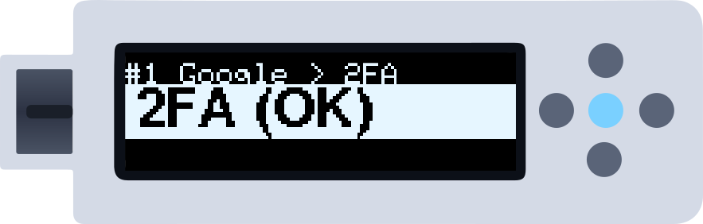
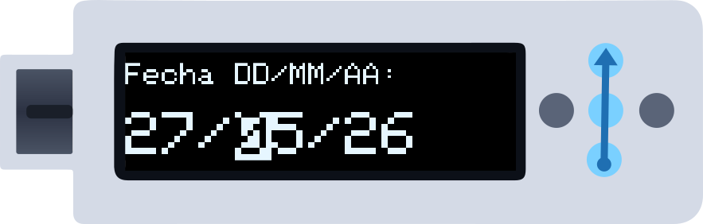
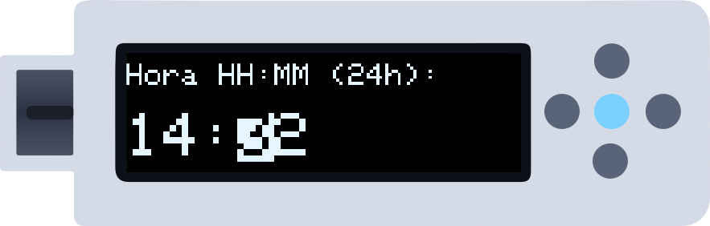
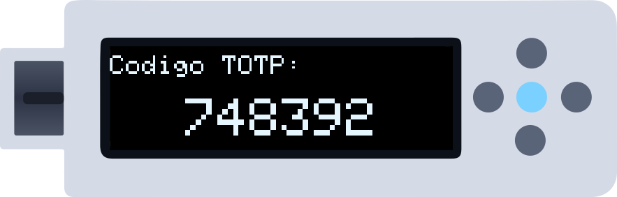

ZeroKeyUSB puede generar **códigos 2FA (TOTP)** sin conexión, los mismos códigos de 6 cifras que verías en una app de autenticación, sin necesidad de móvil. Esta guía explica cómo usarlos. Para añadir un secreto 2FA a una cuenta, ver [Importar credenciales](/es/getting-started/importing-credentials).

<Note>
**Antes de empezar:** la cuenta tiene que tener un secreto 2FA cargado. En su campo 2FA verás entonces `2FA (OK)`; `2FA --` significa que no tiene. Carga antes el secreto desde el web manager.
</Note>

En las ilustraciones una **flecha azul** es un deslizamiento y el **punto central iluminado** un toque; en modo Botones pulsa el punto que va entre paréntesis.

---

## Paso 1 — Ir al campo 2FA

En la cuenta, desliza **hacia arriba** (Abajo) para pasar del sitio al usuario, a la clave y luego a **2FA**. Toca el centro (Centro).

---

## Paso 2 — Meter la fecha (una vez por sesión)

El dispositivo no tiene un reloj que siga en hora mientras está desconectado, así que pide la fecha y la hora **una vez** cada vez que lo conectas. Primero la fecha, como `DD/MM/AA`.

| Movimiento | Gestos | Botones |
|------------|--------|---------|
| Cambiar la cifra elegida | Deslizar arriba / abajo | Arriba / Abajo |
| Pasar a la cifra siguiente / anterior | Deslizar a la derecha / izquierda | Derecha / Izquierda |
| Confirmar la fecha | Tocar el centro | Centro |

En esta pantalla la selección sigue al dedo (deslizar hacia arriba = la cifra sube). Deja el dedo en el último punto para que siga avanzando.

---

## Paso 3 — Meter la hora

Igual, ahora `HH:MM` en hora local de 24 horas. Toca el centro para calcular el código.

<Tip>
Usa tu hora local tal como la marca tu reloj; el dispositivo no aplica zona horaria.
</Tip>

---

## Paso 4 — El código

Aparece el código de 6 cifras. Se renueva solo cada 30 segundos mientras está en pantalla.

*Pon el cursor en la casilla 2FA de la web o la app y **toca el centro**: el dispositivo escribe las 6 cifras en tu ordenador y vuelve al campo 2FA de la cuenta.*

---

## Siguientes códigos

Mientras el dispositivo siga conectado, recuerda la fecha y la hora: la próxima vez que toques el centro en un campo 2FA (de cualquier cuenta) el código sale directamente.

---

## Referencia rápida

| Pantalla | Gestos | Botones |
|----------|--------|---------|
| Campo `2FA (OK)` | Tocar el centro → código | Centro |
| Campo `2FA --` | Sin secreto cargado: nada que hacer | — |
| Fecha / hora | Deslizar arriba/abajo: cifra · derecha/izquierda: siguiente/anterior · tocar: confirmar | Arriba/Abajo · Derecha/Izquierda · Centro |
| El código | Tocar el centro: escribirlo y volver | Centro |

---

## Siguientes pasos

<CardGroup cols={2}>
  <Card title="Importar secretos 2FA" icon="cloud-arrow-up" href="/es/getting-started/importing-credentials">
    Cómo cargar en una cuenta el secreto de tu servicio.
  </Card>
  <Card title="Crea tu primera credencial" icon="key" href="/es/getting-started/first-credential">
    Si aún no tienes cuentas, empieza aquí.
  </Card>
</CardGroup>
