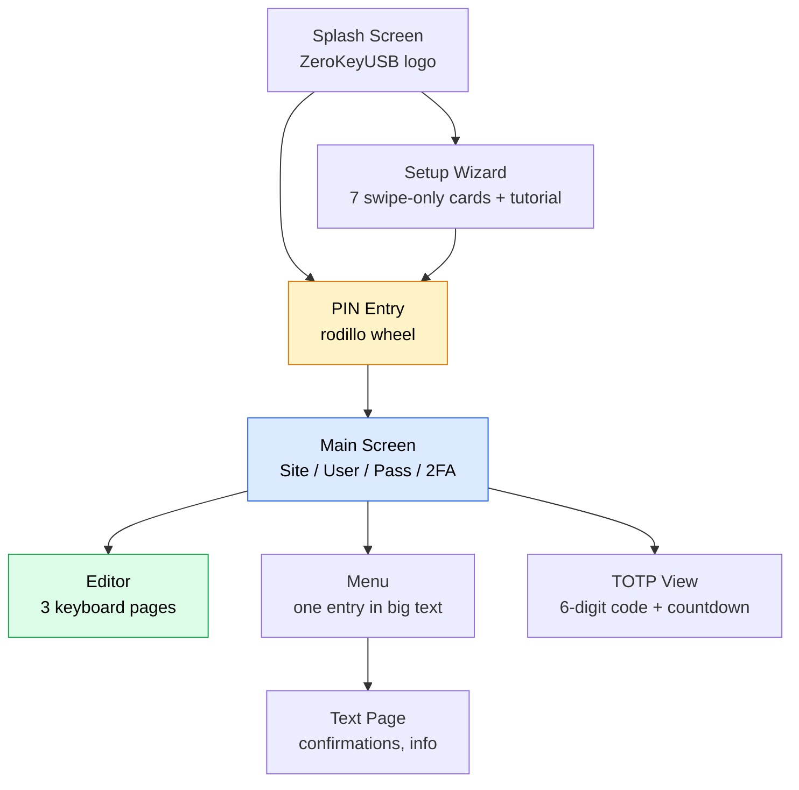
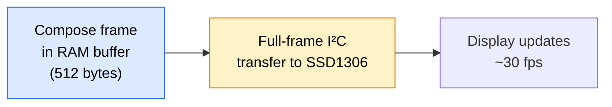

## 128×32 pixels with purpose

ZeroKeyUSB uses a **white OLED panel** (SSD1306 controller, I²C at `0x3C`) with a 128×32 pixel resolution.  
The firmware keeps the interface intentionally minimal: large typography, clear layout, and smooth transitions that remain legible even in low light.

---

## Screen hierarchy

---

## Rendering pipeline

1. **Frame buffer build** — the application composes the entire screen in a 512-byte RAM buffer using `Adafruit_SSD1306` drawing functions: `setCursor()`, `print()`, `drawRect()`, `fillRect()`, `drawBitmap()`.
2. **Full-frame transfer** — `display.display()` sends all 512 bytes to the OLED via I²C in a single burst.
3. **Refresh pacing** — the cooperative main loop redraws only when screen state changes, avoiding unnecessary I²C traffic.

---

## Screen anatomy (1.1.0)

Since firmware 1.1.0 the menu, the accounts and the setup wizard share one layout, so the user learns it once:

| Zone | Rows | Content | Font |
|------|------|---------|------|
| **Context** | 0–6 | Where you are: `#3 Gmail > User`, `SETTINGS > Hand`, `2/7 HAND` | 5×7 |
| **Band** | 7–24 | The selected value, black on white | FreeSans **Bold** 9 pt; FreeSans 9 pt if it does not fit; 5×7 as a last resort (`drawBigText()`) |
| **Cue** | 25–31 | What is below (`↓ Password`), or an animated gesture cue | 5×7 / animation |
| **Position** | x 125–127 | Place in the list (menus) | — |

Rules followed by every screen: one idea per screen, cues are animated symbols rather than words, two instructions never share a row, and nothing changes without sliding in the direction of the gesture.

---

## Screen types

### PIN entry screen ("rodillo")
- A **wheel** at x 98–117: the selected value lit in a 20×16 window (FreeSans Bold), the previous value above it and the next below it (5×7). After the first digit the wheel holds `0, ✓, 1 … 9`.
- The digits already entered are drawn big to the left of the wheel, 20 px apart, the newest next to it; older ones scroll off the left edge.
- An arrow beside the wheel beats towards the row (or, in Buttons mode, towards the Right pad).
- Up/Down rolls the value inside its window (a box-limited vertical slide). Adding a digit animates it travelling from the window into the row while the row shifts left by one step (6 frames, ~110 ms); erasing plays the reverse. The animation is rebuilt from the state on screen — no extra copy of the PIN is kept.

### Main credential screen
- Context row: `#N > Site` on the site field, `#N <site> > <field>` on the others.
- Band: the selected field in big text — site, user, **password** or `2FA (OK)` / note. Values wider than the band scroll inside it (FreeSans 9 pt, ~40 px/s, 1.2 s pause at each end) via `refreshMainScrollIfNeeded()`.
- Cue row: `↓ <user>` under the site, `↓ Password` under the user (the name, never the value), `↓ 2FA` under the password when the slot has one.
- The virtual slot after the last account shows `NEW ACCOUNT` / `+ Add new`.

### Editor screen
- **Three keyboard pages** selectable with Up/Down:
  - Page 1 (`EDIT_KB1`): `A-Z`, brackets, symbols
  - Page 2 (`EDIT_KB2`): `a-z`, punctuation
  - Page 3 (`EDIT_KB3`): `0-9`, space, special characters
- Left/Right controls: cursor position (◀ / ▶), random character, backspace
- Selected character highlighted with inverted colors

### Menu screen
- One entry at a time: the path (`SETTINGS > Hand`) in the context row, the value (`Right-handed`) big in the band, the next entry under it, and a 3 px position bar on the right.
- Entries labelled `Name: value` show the name in the path and the value in the band.

### Setup wizard cards
- Seven cards in the same layout: language, hand, (tutorial), keyboard, create PIN, PIN saved, ready.
- Cards with a choice keep a 7 px column on the right for an animated double arrow that grows from the middle to both ends (`drawGrowArrowVertical()`: swipe up/down to change). Every card has an arrow gliding right-to-left along the bottom row (`drawGlideArrow()`: swipe that way to go on). The two cues take turns (~1 s each, 90 ms frames) so only one thing moves at a time.

### Tutorial
- Six interactive lessons (`zerokey-tutorial.cpp`): a pad cross on the left animates the move, the right pane names the action, and the user must perform it. A summary card closes with the same glide cue.

### Notices and final screens
- `renderBigNotice()`: small title bar, value in big text (e.g. `Hand` / `Left-handed` after a change).
- After a factory reset the device shows a fixed `RESET DONE` / `Unplug it` card and stops answering the pads until it is unplugged.

### TOTP code screen
- Large **2× text size** for the 6-digit code.
- Countdown in seconds: `"Expires in: XXs"`.
- Refreshes automatically every second.
- Touch any pad to return to credentials.

---

## Typography & assets

| Asset | Format | Size | Usage |
|-------|--------|------|-------|
| **Default font** | Adafruit GFX built-in | 6×8 px | Context and cue rows, text pages |
| **FreeSans 9 pt Bold / Regular** | Adafruit GFX fonts | cap height 12 px, ~1.9 KB each | The band, the PIN digits (1.1.0) |
| **Text size 2** | 2× scaled | 12×16 px | TOTP codes, splash |
| **Icons** | PROGMEM bitmaps | 16×16 px | Menu items (backup, settings, danger, info) |
| **Device SVGs** | Vector in `/images/` | Various | Documentation touch pad illustrations |

All fonts and icons are stored in **Flash (PROGMEM)** — no runtime loading from EEPROM.

---

## Slide transitions (1.1.0)

The screens are laid out as a strip — the menu left of account 1, accounts left to right, submenus to the right of their menu, the search above the account — and moving along it slides the new screen in from that side.

1. Before a press is handled, `requestTransition()` copies the frame on screen (`slideFor()` in `zerokey-io.cpp` picks the direction).
2. When the handler redraws, `zerokeydisplay()` pushes **5 in-between frames** that shift the old and new frames (columns for horizontal slides, bits of each column for vertical ones), then the final one. Each push takes ~13 ms (the driver runs the bus at 400 kHz for frame transfers), so a slide costs ~80 ms.
3. The panel orientation is taken into account: in the right-handed default the panel is rotated 180°, so "from the right" for the user is "from the left" in the buffer.

| Move | Slide |
|------|-------|
| Next / previous account | Horizontal, full screen |
| Next / previous menu entry or account field | Vertical, rows 7–31 (the context row stays still) |
| Open a submenu / go back | Horizontal |
| Open the search / back to the account | Vertical, full screen |
| PIN wheel | Vertical, only inside the value window (`requestBoxTransition()`) |

If the handler did not change anything there is no animation. Auto-repeat (swipe-and-hold) does not slide, so lists move at full speed — except the PIN wheel, whose small roll fits within the 180 ms repeat.

## Scrolling

- **Band marquee**: values wider than the band scroll horizontally (see the main screen above).
- **Text pages**: confirmation and info pages scroll vertically with Up/Down and show a scrollbar thumb.

---

## Visual feedback

| Feedback type | Implementation |
|--------------|----------------|
| **Selection highlight** | Inverted colors (black text on white background) |
| **Long-press progress** | Two white pens fill along the screen edge via `drawLongPressProgress()`, with a short black lead ahead of each pen so the advance is easy to follow |
| **Activity spinner** | Frame-based animation via `renderActivityScreen()` |
| **Progress bar** | `renderProgress()` with title, subtitle, done/total |
| **Typing indicator** | `renderTypingActivity()` shows characters typed vs. total |
| **Context row** | Top row shows where you are (`#3 Gmail > User`, `SETTINGS > Hand`) |
| **Gesture hint** | `renderGestureHint()`: a pad cross with the swipe to make, shown for 1.2 s when an outer pad is touched alone in Gestures mode |

---

## Inactivity blanking

After **1 minute with no touch input**, the firmware powers the OLED off
(`SSD1306_DISPLAYOFF`) from `handleButtonChecker()`. This is a **display-only**
sleep:

- The vault is **not** locked and `programPosition` does not change — waking
  lands on the exact same screen.
- **Any touch** wakes the panel (`SSD1306_DISPLAYON`); that first touch is
  consumed, so it only wakes and does not also navigate.
- A host `FIND` from the [browser extension](/getting-started/browser-extension)
  also wakes the panel so the jump is visible.

The MCU keeps running while blanked (timers, TOTP steps, serial). Automatic
periodic redraws (e.g. the TOTP countdown) do **not** count as activity — only
touch and host commands do.

---

## Display security

- Sensitive fields (passwords, TOTP codes) are **displayed briefly and cleared** — the frame buffer is overwritten on the next screen transition.
- The display **blanks after 1 minute of inactivity but does not lock** (see above); locking the vault still requires power removal (USB disconnection).
- While typing to host, `renderTypingActivity()` shows progress without displaying the credential content.
- No decrypted credential is ever stored in the OLED controller's GDDRAM beyond the current frame.

<Note>
The OLED sits behind the sealed epoxy encapsulation, providing excellent contrast and resistance to scratches, dust, and moisture.
</Note>
