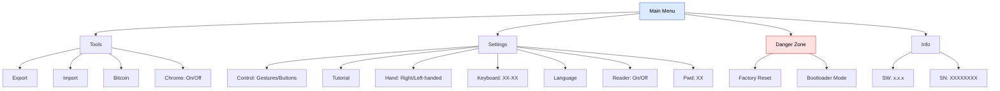
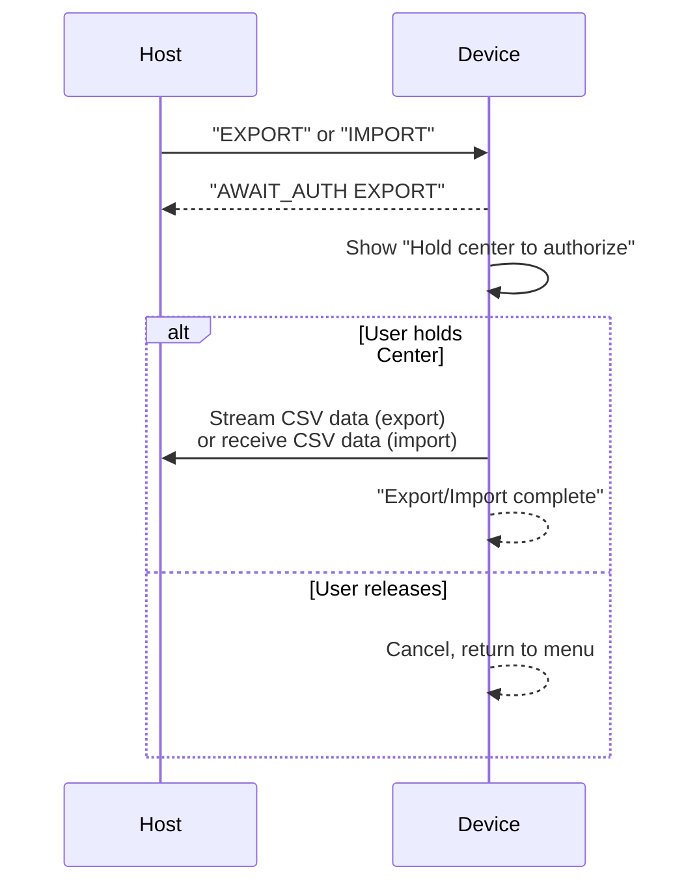
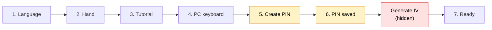

## Simple control, powerful features

ZeroKeyUSB has no buttons, no apps, and no hidden menus — only **five golden touch points** that control everything.  
The menu becomes accessible **after entering your Master PIN** by scrolling past the last credential slot.

---

## Menu structure

---

## Navigating the menu

| Action | Gestures | Effect |
|--------|----------|--------|
| **Up ↑** | Swipe top → bottom | Previous entry |
| **Down ↓** | Swipe bottom → top | Next entry |
| **Center ●** | Tap the centre | Open the submenu / run the entry |
| **Left ←** | Swipe left → right | Back to the parent menu; from the main menu, out to the "+ Add new" slot (or the last account when every slot is used) |
| **Right →** | Swipe right → left | Out of the menu to account 1, from any level |

Since 1.1.0 the menu shows **one entry at a time** in big text (`ZerokeyMenu::displayMenu()`): the path in the top row, the value in the band, the next entry under it and a position bar on the right. Up/Down slide vertically below the path row; entering or leaving a submenu slides horizontally (see [Display System](/firmware/display)).

---

### 🧰 Tools

<Note>This submenu was called **Backup** in older firmware; it was renamed **Tools** when the Bitcoin wallet was added.</Note>

| Item | Action |
|------|--------|
| **Import** | Receives credentials from the host via USB serial (CDC). Device shows "Waiting for data from the web app." |
| **Export** | Sends all 61 credential slots as plaintext CSV over USB serial. Requires long-press Center authorization. |
| **Bitcoin** | Airgapped Bitcoin wallet: create wallet, show the 12-word seed (screen-only) and export a watch-only `zpub`. See [Bitcoin signer](/firmware/bitcoin-signer). |
| **Chrome: On/Off** | Enables the host `FIND` command used by the [browser extension](/getting-started/browser-extension) to jump the on-device search. Default **On**; when Off the firmware ignores the command. Saved in EEPROM (`0x000D`). |

The export/import flow shows an authorization prompt before transferring any data:

<Warning>
Export sends **plaintext credentials** over USB serial. Only perform this on a trusted computer.
</Warning>

---

### ⚙️ Settings

| Item | Action |
|------|--------|
| **Control: Gestures / Buttons** | Input mode (1.1.0): swipe across the pads, or press them one by one. Saved in EEPROM (`0x000E`; blank = Buttons, so units updated from 1.0 keep their behaviour). Switching to Gestures runs the tutorial. See [Touch Input Handling](/firmware/io-touch-handling). |
| **Tutorial** | Replays the animated interactive tutorial (`runInputTutorial()`). |
| **Hand: Right-handed / Left-handed** | Turns the display 180° and remaps the pads so "up" stays the pad at the top of the screen. Right-handed (panel rotation 2) is the default. Saved in EEPROM. |
| **Keyboard: XX-XX** | Cycles through 9 keyboard layouts (EN-US → DA-DK → DE-DE → ES-ES → FR-FR → HU-HU → IT-IT → PT-PT → SV-SE → EN-US). Saved in EEPROM. |
| **UI Language** | Cycles the on-screen interface language (English ↔ Spanish). Saved in EEPROM. |
| **Reader: On/Off** | Toggles the persistent HID [screen-reader mode](/firmware/screen-reader) — types the screen over USB so a unit with a dead display is still usable. Saved in EEPROM. |
| **Pwd: XX** | Cycles the format used by `Rand` when generating a password: `Symbols` → `Numeric` → `a-z 0-9` → `Aa-z 0-9` → `Words` → `Words+Num`. All formats draw from the ATECC608A TRNG and cap at 16 characters. Saved in EEPROM (`0x0004`). See [Edit a credential](/getting-started/edit-credential). |

---

### ⏱️ TOTP

TOTP is accessed from the credential view, not the main menu. When viewing a credential, scroll **Down past Password** to the **2FA** field:

- If no TOTP secret exists for that slot → shows "No TOTP secret" for 2 seconds.
- If time is not synced → shows "Time not set — Request host time" and sends `REQTIME` over serial.
- If ready → displays a **6-digit code** with a 30-second countdown timer. Refreshes automatically each period. Touch any pad to return.

---

### ⚠️ Danger Zone

Every action in this section shows a **confirmation page** that fires only while the centre is **held** for 1.5 s (a tap does nothing); Left cancels:

| Item | Effect | Reversible? |
|------|--------|-------------|
| **Factory Reset** | Runs `eraseAll()` (3-second countdown, encrypted blanks over all 61 slots + clears TOTP metadata) and resets the provisioning flag to `0x00`, so the next boot starts the setup wizard. It then shows a fixed "unplug it" card and halts — no pad is answered until the device is unplugged. | ❌ No |
| **Bootloader Mode** | Sets double-reset magic word (`0xF01669EF` at `0x20007FFC`), then issues `NVIC_SystemReset()`. Device reboots into USB DFU bootloader for firmware flashing. | ✅ Yes (reflash) |

---

### ℹ️ Info

Read-only submenu showing:
- **SW: x.x.x** — firmware version from `zerokeyInfo::getSoftwareVersion()` (`1.1.0`)
- **SN: XXXXXXXX** — hardware serial from the SAMD21 unique ID registers
- **MCU**, **Sec rev**, **Sec SN** — microcontroller ID and the ATECC608A revision and serial
- **Slots: used/61** and **Built:** — slot usage and build date

---

## Setup wizard

The setup wizard runs on first boot (or after a factory reset). Since 1.1.0 it is **7 visible steps**, each a card in the menu layout, driven **only by swipes** — a centre tap just restarts the animated cue, so a stray tap can never skip a step. The wizard always switches the input mode to Gestures; Buttons can be chosen afterwards in Settings.

| Gesture on a card | Effect |
|-------------------|--------|
| Swipe up / down | Change the value (language, hand — the screen turns at once — or keyboard layout) |
| Swipe right → left | Next step. On "Create PIN" it opens the PIN wheel; on "Ready" it goes to the PIN screen |
| Swipe left → right | Previous step (going back skips the tutorial and the key generation) |

On the wizard's PIN wheel, erasing with no digit entered returns to the "Create PIN" card. User guide: [Initial Setup](/getting-started/setup-wizard).

---

## Design philosophy

The menu system is intentionally minimalist:
- No deep submenus — every option is **two taps away** from the main menu.
- All destructive actions require holding the centre on a dedicated confirmation page.
- One layout and one set of moves on every screen: swipe right to left to go on, left to right to go back, up/down to change, tap to act, hold for the strong action.
- Menu items dynamically update their labels (e.g., keyboard layout shows current selection).

<Note>
ZeroKeyUSB requires no drivers or software installation.  
It's recognized as a standard USB keyboard on any operating system.
</Note>
