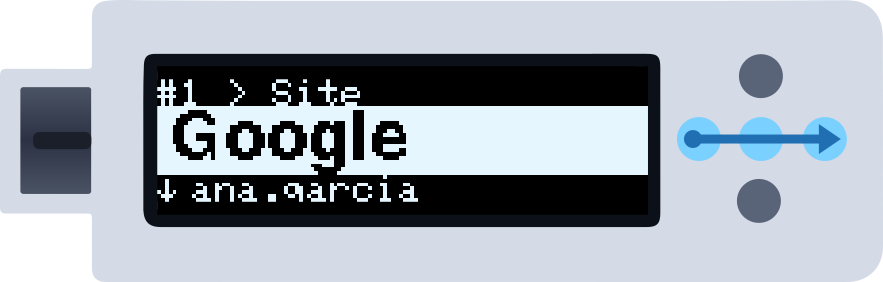
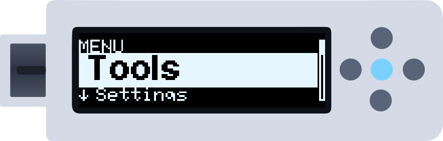
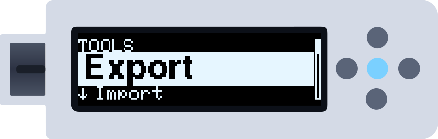
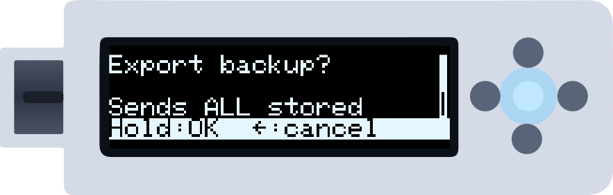
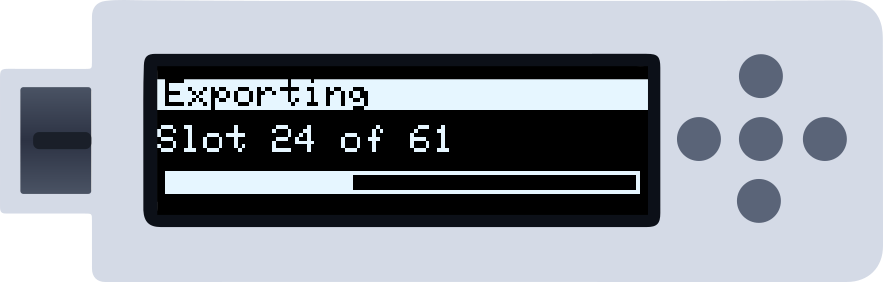
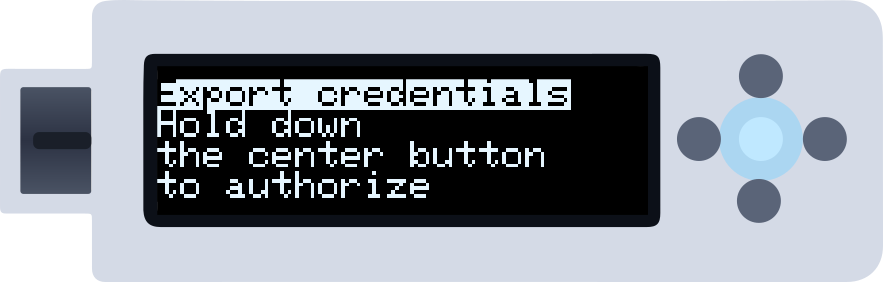

A backup protects you against loss or damage of the device. ZeroKeyUSB makes the process **deliberate**: no credential leaves the device until you physically hold the centre dot to authorise it.

<Warning>
The backup is emitted as **plaintext** over USB serial. Encrypt it right after capturing it (GPG, age, 7z with password…) and store it offline.
</Warning>

---

## Before you start

| You need | For |
|----------|-----|
| The device unlocked | Export only works with the PIN already entered |
| A serial tool | Web manager, `screen`, `minicom`, PuTTY or similar at 115200 bps |
| A safe place to store the file | Encrypted disk, locked SD card, etc. |

---

There are two ways to start an export. Both end with you **holding the centre** on the device: nothing leaves it without that.

- **From the web manager** (easiest): it asks the device for the export, and the device asks you to authorise it — see [the web manager way](#the-web-manager-way) below.
- **From the device menu**: Tools → Export, as in the steps that follow. Have your serial tool already connected and listening, because the data is sent straight away.

In the illustrations a **blue arrow** is a swipe, a **lit centre dot** a tap and a **halo** a hold; in Buttons mode press the dot named in brackets.

## Step 1 — Open the menu

From account 1, swipe **left to right** (Left): the menu slides in from the left. See [Navigate the menu](/getting-started/menu-navigation) if in doubt.



---

## Step 2 — Tools

**Tools** is the first entry of the menu. Tap the centre (Centre) to open it.



---

## Step 3 — Export

**Export** is the first entry of Tools. Tap the centre.



---

## Step 4 — Confirm by holding

A confirmation page reminds you that **all** credentials will be sent to the computer in plain form. It only goes ahead if you **hold the centre for about 1.5 seconds**: a border fills around the screen while you hold. A tap does nothing; swiping left to right (Left) cancels.



---

## Step 5 — Sending

The device reads each slot and sends it as a CSV line over USB, showing its progress. You don't have to do anything.



*It goes through all 61 slots and then returns to the menu.*

---

## The web manager way

When the [web manager](https://zerokeyusb.com/manager) starts an export, the device shows:



*Hold the centre for about a second to authorise it (Buttons: hold Centre). The device shows that it is sending, and "Export complete" when it has finished.*

---

## Step 6 — Capture the CSV on the host

While the device sends, on your serial terminal you'll see lines appear:

```csv
61
0,Google,user1,contrasena1,JBSWY3DPEHPK3PXP
1,Apple,user2,password,
2,Netflix,user3,Atalaya,
3,github,user4,no me acuerdo,JBSWY3DPEHPK3PXP;algo=SHA256
4,Amazon,comprador99,123456,
...
```

| Field | Meaning |
|-------|---------|
| Line 0 | Total number of slots (always `61`) |
| `slotIndex` | 0–60 |
| `site` | Site (≤32 chars) |
| `username` | Username (≤32 chars) |
| `password` | Password |
| `totpSecret` | Optional — Base32 (with optional `;algo=SHA256`) or empty |

Save the whole output to a file (`zerokeyusb-2026-05-27.csv`, for example). The web manager has a "Save" button that does this for you.

---

## Step 7 — Encrypt immediately

<Warning>
The CSV you just saved contains **all** your passwords in cleartext. Encrypt it as soon as you've captured it and delete the unencrypted version.
</Warning>

```bash
# Option A: GPG (symmetric, AES-256)
gpg -c --cipher-algo AES256 zerokeyusb-2026-05-27.csv
shred -u zerokeyusb-2026-05-27.csv

# Option B: age with passphrase
age -p -o zerokeyusb-2026-05-27.csv.age zerokeyusb-2026-05-27.csv
shred -u zerokeyusb-2026-05-27.csv

# Option C: 7z with a strong password (Windows)
7z a -p -mhe=on zerokeyusb-2026-05-27.7z zerokeyusb-2026-05-27.csv
del zerokeyusb-2026-05-27.csv
```

---

## When to back up

| When | Why |
|------|-----|
| After adding or importing several credentials | So you don't lose new work |
| Before factory reset or firmware reflashing | The reset is irreversible |
| Before any **Danger** submenu action | Same |
| Periodically | As part of your security routine |

---

## Best practices

| Practice | Why |
|----------|-----|
| Encrypt right away | Plain CSV is a huge risk |
| Store in ≥ 2 separate physical locations | Protects against single-disk/cloud failure |
| Test a restore now and then | Guarantees the file is usable when you need it |
| Shred old backups | Reduces exposure window |
| Name with date (`YYYY-MM-DD`) | So you know which is most recent |

---

## Next steps

<CardGroup cols={2}>
  <Card title="Import credentials" icon="cloud-arrow-up" href="/getting-started/importing-credentials">
    Restore from a backup or migrate from another manager.
  </Card>
  <Card title="Navigate the menu" icon="bars" href="/getting-started/menu-navigation">
    Learn the rest of the menu options.
  </Card>
</CardGroup>
