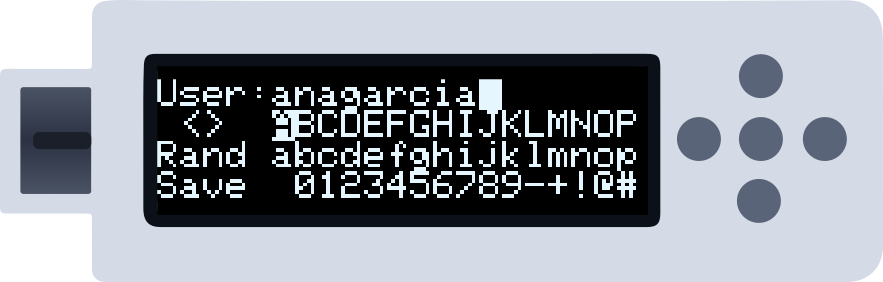
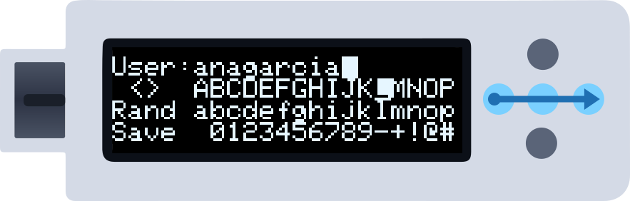
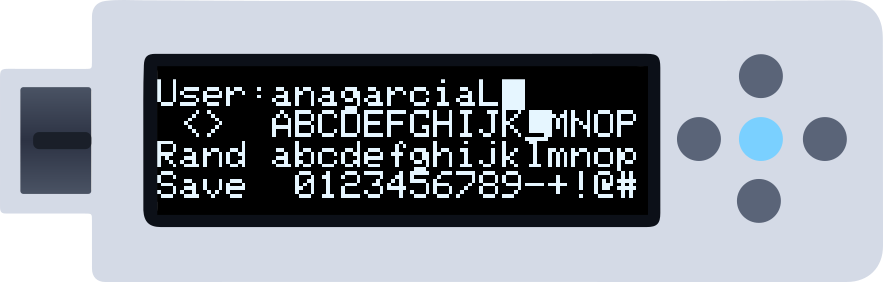
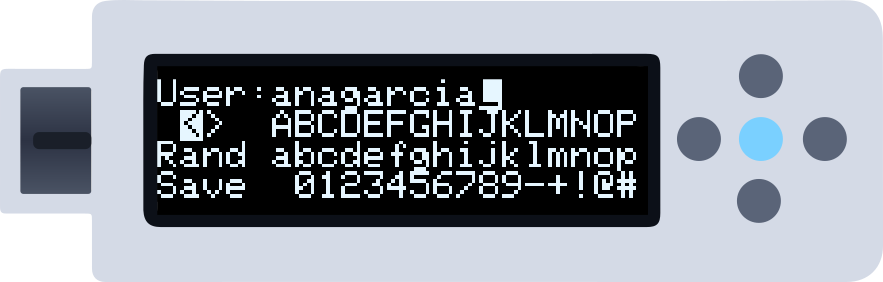
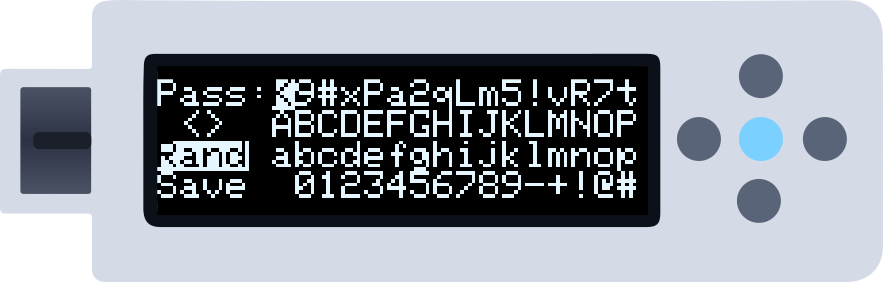
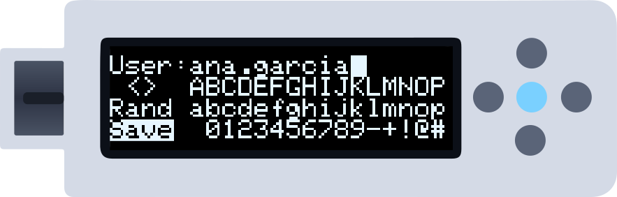

This guide details every operation in the on-device editor. If you just want to create your first credential, start with [Create your first credential](/getting-started/first-credential). In the illustrations a **blue arrow** is a swipe, a **lit centre dot** a tap and a **halo** a hold; in Buttons mode press the dot named in brackets.

---

## Step 1 — Find the account

On your accounts, swipe **right to left** (Right) for the next one and **left to right** (Left) for the previous one. To go faster, keep your finger on the last dot after the swipe: it jumps 10 accounts at a time.

*The top row shows the account number (`#4`) and the field you are on.*

<Tip>
With many accounts, swipe **down** (Up) on the site field to open the alphabetical search.
</Tip>

---

## Step 2 — Choose the field and open the editor

Swipe **up** (Down) to go from **Site** to **User**, **Password** and **2FA** (if the account has one); swipe **down** (Up) to go back. On the field you want, **hold the centre** for about a second.

*A border fills around the screen; when it has closed, lift your finger and the editor opens. A **short** tap would type the field on the computer instead.*

---

## Step 3 — Editor anatomy

| Element | Function |
|---------|----------|
| Row 1 | The field (**up to 32 characters**; it scrolls past 16) with the cursor, inverted, where the next character goes |
| Row 2 — `<` `>` | Move that cursor one position left or right |
| Row 2 — keyboard | Uppercase `A`–`Z` and `( ) [ ] { }` |
| Row 3 — `Rand` | Fills the field with a strong random value (format set in **Settings → Pwd**) |
| Row 3 — keyboard | Lowercase `a`–`z` and `< > | \ / ?` |
| Row 4 — `Save` | Saves and returns to the account |
| Row 4 — keyboard | Space, `0`–`9` and symbols |

Each keyboard row shows 16 keys at a time and slides along as you move past the edge.

---

## Step 4 — Move across the keyboard

In the editor the selection **follows your finger**: swipe right or left to move along a row, up or down to change row.

*Keep your finger on the last dot after a sideways swipe and the selection keeps moving. Past the first key of a row you reach the controls on its left (`<` `>`, `Rand`, `Save`).*

---

## Step 5 — Insert a character

With the character selected, **tap the centre**. It is written at the cursor, which moves one position on.

---

## Step 6 — Move the field cursor

To change a character in the middle of the field, move to `<` or `>` (row 2, left) and tap the centre: the cursor moves one position. Then go back to a keyboard row and insert the new character.

<Tip>
Characters **overwrite** what is under the cursor; they don't push the text along. To "delete" one, put a space over it (the first key of the numbers row).
</Tip>

---

## Step 7 — Generate a random password

Instead of typing a password, move to **Rand** and tap the centre. The field fills with a strong random value of **up to 32 characters**, in the format chosen in **Menu → Settings → Pwd**:

| Setting | Format | Example |
|---------|--------|---------|
| `Symbols` (default) | Full printable set (letters, digits, symbols) | `t7#Kp!2r$Qm9^Za5Wd8&Bv3Ln6@Xj1Qz` |
| `Numeric` | Digits | `48201937560428173905641820937584` |
| `a-z 0-9` | Lowercase letters and digits | `k3m9xq1z7r4p2n8wj5c6vb0hd1ft9gs2` |
| `Aa-z 0-9` | Mixed-case letters and digits | `Kp3Mx9Qz1Rt4Nb8yWd2Fc7Hj5Lv0Gs6R` |
| `Words` | Words joined by a random separator | `Ocean-Cargo-Mint-River-Sun` |
| `Words+Num` | The same, plus a 2-digit group | `River_28_Mango_Ocean_Tiger` |

`Rand` on the **site** or **user** field always uses `Symbols`.

*Not happy with it? Tap the centre again for another one.*

---

## Step 8 — Save

Move to **Save** (row 4, left) and tap the centre. The changes are encrypted and stored, and you return to the account.

<Warning>
Leaving the editor any other way than **Save** discards the changes. There is no confirmation.
</Warning>

---

## Quick reference

| Action | Gestures | Buttons |
|--------|----------|---------|
| Open the editor | Hold the centre on a field | Hold Centre |
| Move along a row | Swipe left / right (keep the finger down to repeat) | Left / Right |
| Change row | Swipe up / down | Up / Down |
| Insert the character | Tap the centre | Centre |
| Move the field cursor | Tap the centre on `<` or `>` | Centre on `<` / `>` |
| "Delete" a character | Put a space over it | Same |
| Random value | Tap the centre on `Rand` | Centre on `Rand` |
| Save and exit | Tap the centre on `Save` | Centre on `Save` |

---

## Next steps

<CardGroup cols={2}>
  <Card title="Set up 2FA" icon="clock" href="/getting-started/totp-codes">
    TOTP secrets are loaded from the computer, not typed on the device.
  </Card>
  <Card title="Create a backup" icon="cloud-arrow-down" href="/getting-started/creating-backups">
    Save your current state before editing many credentials.
  </Card>
</CardGroup>
