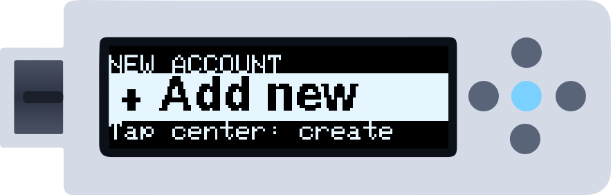
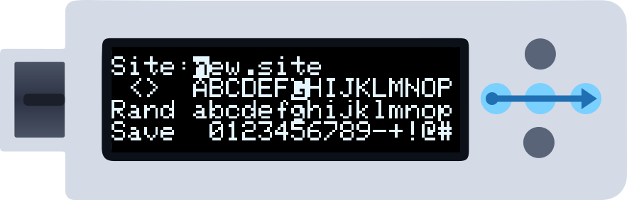
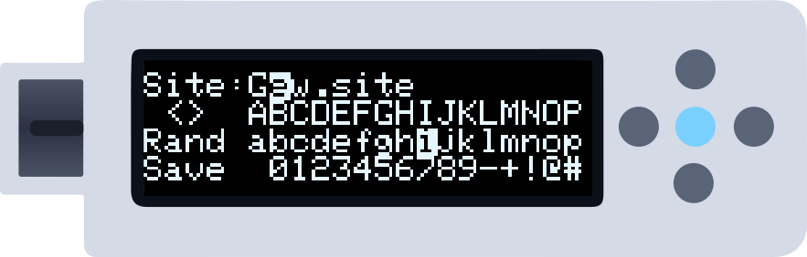
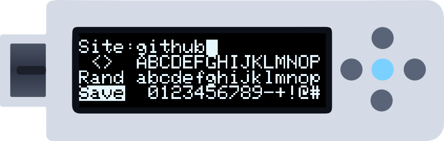
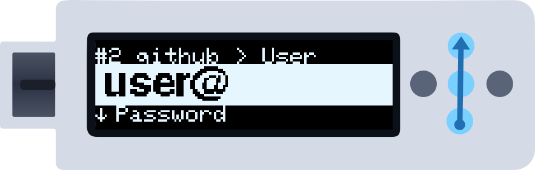
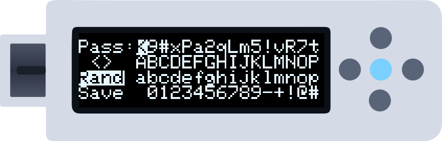
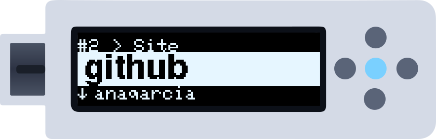

This guide assumes you have already finished the [initial setup](/getting-started/setup-wizard). The illustrations show the move to make on the gold dots: a **blue arrow** is a swipe (it starts where the arrow's tail is), a **lit centre dot** is a tap, and a **lit centre dot with a halo** means hold it. In Buttons mode, press the dot named in brackets. See [Gestures](/getting-started/gestures).

---

## Step 1 — Unlock with the PIN

When you plug the device in, the PIN wheel appears. For each digit: swipe **up or down** to turn the wheel to the number, then swipe **right to left** to add it (Buttons: **Up/Down**, then **Right**).

*After each number the wheel stops on the tick (✓). When the last digit is in, swipe right to left once more on the ✓ to unlock. Swiping left to right erases the last number.*

---

## Step 2 — The example account

On a new device the list is not empty: account 1 is an example, `gmail.com` with user `user@` and password `password1234`, so you can try typing straight away. You can edit it or overwrite it like any other account.

---

## Step 3 — "+ Add new"

After your last account comes **+ Add new**. From account 1, swipe **right to left** (Right) once per account until it appears. Then **tap the centre** (Centre).

---

## Step 4 — The new account

The device fills the first free slot with placeholder values (`new.site` / `user@` / `pass`) and shows it. The top row tells you where you are: `#2 > Site`.

*To change the site, **hold the centre** for about a second (Buttons: hold Centre). A border fills around the screen; when it has closed, lift your finger and the editor opens. A short tap would instead **type** the field on your computer.*

---

## Step 5 — The editor

The editor fills the screen with four rows:

1. **Top:** the field being edited, with the cursor (inverted) where the next character goes.
2. **Row 2:** `<` `>` to move that cursor + the **uppercase** keyboard.
3. **Row 3:** `Rand` (random fill) + the **lowercase** keyboard.
4. **Row 4:** `Save` + **numbers and symbols**.

In the editor the selection **follows your finger**: swipe right to move right along a row, swipe down to go to the row below. **Tap the centre** to insert the selected character.

*Swipe right (Right) to move along the uppercase row to `G`, then tap the centre: `G` replaces the first letter and the cursor moves on.*

<Tip>
Keep your finger on the last dot after a sideways swipe and the selection keeps moving along the row.
</Tip>

---

## Step 6 — Lowercase, numbers and symbols

Swipe **down** (Down) to move from the uppercase row to the lowercase row, and once more to numbers and symbols. Swipe **up** (Up) to go back.

*Insert the rest of the letters with a tap on the centre.*

<Tip>
Characters **overwrite** what is under the cursor; they don't push the text along. To clear the leftover letters of `new.site`, insert a space (the first key of the numbers row) over each of them.
</Tip>

---

## Step 7 — Save

When the field reads as you want, move to **Save** (row 4, left) — swipe down from `Rand`, or left from the start of the numbers row — and **tap the centre**.

*The field is encrypted and saved, and you return to the account.*

---

## Step 8 — The user field

Back on the account, swipe **up** (Down) to move from the site to the **user**: the new field rises from below and the top row now reads `#2 github > User`.

*Hold the centre to edit it, exactly as you did with the site.*

---

## Step 9 — A random password with Rand

Swipe up once more to reach the **password** and open the editor. Instead of typing it, move to **Rand** and tap the centre: the field fills with a strong random password, in the format chosen in **Menu → Settings → Pwd**.

*Not happy with it? Tap again to get another. Then go to **Save** and tap the centre.*

---

## Step 10 — Done

The account is saved. On the **site** field, a tap on the centre types `user` + `TAB` + `password` + `ENTER` on your computer, as if you were typing it. On the user or password field, a tap types just that field.

*Put the cursor in the login form's user box on your computer and tap the centre.*

---

## Next steps

<CardGroup cols={2}>
  <Card title="Edit a credential" icon="pen-to-square" href="/getting-started/edit-credential">
    Every editor operation in detail.
  </Card>
  <Card title="Set up 2FA" icon="clock" href="/getting-started/totp-codes">
    Use TOTP codes for two-factor logins.
  </Card>
  <Card title="Create a backup" icon="cloud-arrow-down" href="/getting-started/creating-backups">
    Export your credentials to a safe file.
  </Card>
  <Card title="Gestures" icon="hand-pointer" href="/getting-started/gestures">
    All the moves, on every screen.
  </Card>
</CardGroup>
