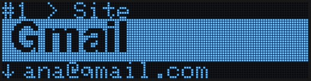
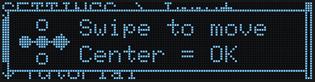
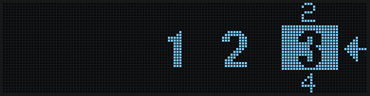
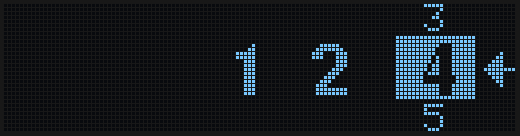
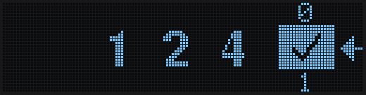
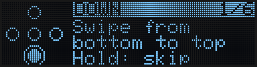
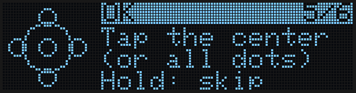
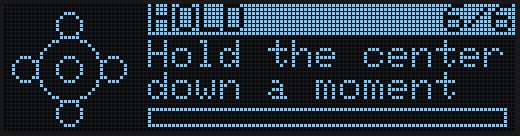
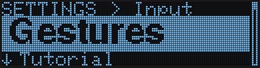

Since firmware **1.1.0**, ZeroKeyUSB is driven by **swiping** your finger across the gold dots instead of pressing them one by one. You no longer have to hit a small dot exactly: what counts is the direction your finger travels. If you prefer the classic way, you can switch back to pressing the dots in **Menu → Settings → Control** (see [Buttons or Gestures](#buttons-or-gestures)).

<Tip>
You can try every move in the [online simulator](https://zerokeyusb.com/simulador.html) before using the device: drag the mouse (or your finger) across the dots.
</Tip>

---

## Every screen looks the same

Every screen has the same three parts, so once you know one you know them all:

| Part | Where | What it tells you |
|------|-------|-------------------|
| **Where you are** | Top row, small | The account, the menu or the step you are on (`#3 Gmail > User`, `SETTINGS > Hand`, `2/7 HAND`) |
| **What matters** | The big lit band | The value you can act on: the site, the user, the option… |
| **What comes next** | Bottom row (and right edge) | What is below (`↓ Password`), or an animated arrow showing the move to make |

---

## The moves

| Move | What it does — on every screen |
|------|--------------------------------|
| **Swipe right to left** | **Go on**: next account, next step, from the menu to your accounts |
| **Swipe left to right** | **Go back**: previous account, previous step, back out of a submenu. From account 1 it opens the menu |
| **Swipe up or down** | **Change what is in the band**: the next or previous field, option or value |
| **Tap the centre** | **Act** on what is in the band: type it on the computer, open the submenu, apply the setting |
| **Hold the centre** | The strong action: edit the field; confirm something irreversible |

Think of it as dragging the screen, like on a phone: when you swipe right to left, the next account slides in from the right. On the few screens with a cursor — the on-device editor, the 2FA date and time, the search — the cursor simply follows your finger.

A swipe goes **across the centre dot**: from one edge dot, through the centre, to the opposite edge dot. Taps are forgiving too: touching the centre together with a neighbour, or all five dots at once, still counts as a centre tap.

### Nothing changes without moving

Whatever changes slides in the direction of your finger: the next field rises from below, the next account comes in from the right. Only the part that changes moves — the top row stays still.

### Keep your finger down

- In lists (the menu, the PIN wheel), swipe and **keep your finger on the last dot** to keep moving.
- On your accounts, swipe sideways and keep your finger down to **jump 10 accounts** at once.

### Touched a single edge dot?

Touching only an edge dot does nothing — it would be too easy to do by accident. Instead, a small picture appears showing the swipe that does what you wanted.

---

## Entering the PIN

The PIN screen follows the same rules. On the right there is a **wheel**: the selected number is lit, with the one before it above and the next one below. The digits you have entered sit to its left.

| Move | What it does |
|------|--------------|
| **Swipe up or down** | Turns the wheel: the number rolls the way your finger goes |
| **Swipe right to left** | Pushes the selected number into the row, which slides left to make room |
| **Swipe left to right** | Pulls the last number back into the wheel, ready to correct it |
| **Right to left on ✓** | After each number the wheel stops on the ✓. The same swipe confirms the PIN |

| Add a number | Erase the last one |
|---|---|
|  |  |

A tap does nothing on the PIN screen, so the PIN can never be confirmed by accident.

---

## The tutorial

The first time you set up the device, a short animated tutorial teaches each move: it shows the swipe, waits for you to do it and says **Great!** when you get it right. Hold the centre to skip a lesson. You can replay it any time from **Menu → Settings → Tutorial**.

| Lesson | Tap | Hold |
|---|---|---|
|  |  |  |

---

## Buttons or Gestures

**Menu → Settings → Control** switches between:

- **Gestures** (default): everything described on this page.
- **Buttons**: the classic way — each dot is a button you press (Up, Down, Left, Right, Centre). The screens and the menus are the same; on the PIN screen the arrow points at the Right dot, which adds the number.

Switching to Gestures runs the tutorial straight away. To switch back, open the same entry and tap the centre — that works in both modes.

 Control" />

---

## Right- or left-handed

**Menu → Settings → Hand** turns the screen round so you can hold the device with the dots on either side (Right-handed is the default). The moves stay the same for your finger: "up" is always towards the top of the screen as you read it.

---

## Next steps

<CardGroup cols={2}>
  <Card title="Initial setup" icon="wand-magic-sparkles" href="/getting-started/setup-wizard">
    The 7 steps you see the first time you plug the device in.
  </Card>
  <Card title="Navigate the menu" icon="bars" href="/getting-started/menu-navigation">
    Tools, Settings, Danger Zone and Info.
  </Card>
  <Card title="How the touch input works" icon="microchip" href="/firmware/io-touch-handling">
    Technical detail: how swipes are recognised (Software section).
  </Card>
</CardGroup>
