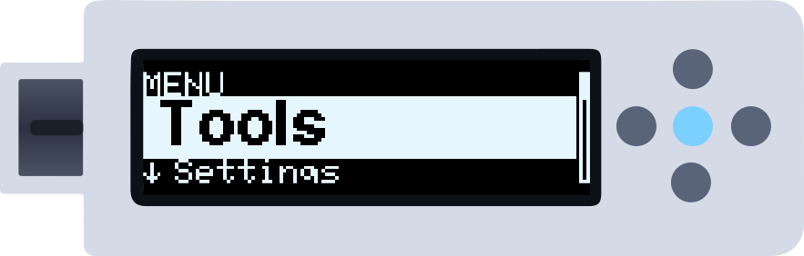

Import loads credentials (site, username, password and optionally a TOTP secret) from a CSV file over USB serial. It happens **after unlocking** the device and requires **physical authorisation**: holding the centre dot.

<Warning>
Import **overwrites** the destination slots. If you already have credentials, **create a backup** ([guide](/getting-started/creating-backups)) before continuing.
</Warning>

---

## Before you start

| You need | How to get it |
|----------|---------------|
| The device unlocked with PIN | Plug it in and enter your PIN |
| A CSV file with your credentials | A previous export, or an export from 1Password / Bitwarden / Keepass adapted to the format (see below) |
| A serial tool | [Web manager](https://zerokeyusb.com/manager) (recommended), `screen`, `minicom`, PuTTY at 115200 bps |

---

There are two ways to start an import, and both need you to **hold the centre** on the device:

- **From the web manager** (recommended): pick the file there; the device asks you to authorise it — see [the web manager way](#the-web-manager-way).
- **From the device menu**: Tools → Import, as in the steps below, then send the CSV from your serial tool.

In the illustrations a **blue arrow** is a swipe, a **lit centre dot** a tap and a **halo** a hold; in Buttons mode press the dot named in brackets.

## Step 1 — Open the menu

From account 1, swipe **left to right** (Left): the menu slides in from the left.


---

## Step 2 — Tools

**Tools** is the first entry of the menu. Tap the centre (Centre).



---

## Step 3 — Import

Inside Tools, swipe **up** (Down) once to reach **Import**, then tap the centre.


---

## Step 4 — Confirm by holding

A confirmation page warns that the import **overwrites all** stored credentials with the data from the computer. It only goes ahead if you **hold the centre for about 1.5 seconds**; a tap does nothing, and swiping left to right (Left) cancels.


*The device then sends `REQUEST_SAVE` over USB serial and waits for the data ("Importing — Waiting for host...").*

---

## Step 5 — Send the CSV from the host

With the device in "waiting for data" mode, send over USB serial:

1. A line with the **total number of records** to import (example: `5`).
2. One CSV line per credential in this format:
   ```csv
   slotIndex,site,username,password[,totpSecret]
   ```

Full example:
```csv
5
0,github.com,alice,MyP@ss123,JBSWY3DPEHPK3PXP
1,gmail.com,bob@gmail.com,correct horse battery staple
2,bank.com,12345678X,s3cur3P@ss,JBSWY3DPEHPK3PXP;algo=SHA256
3,aws-prod,admin,A!7zQ#mYpL2v
4,banca,12345678X,Pin-only2FA
```

Each line is processed like this:

```
Host → device:   "0,github.com,alice,MyP@ss123,JBSWY3DPEHPK3PXP"
Device:          encrypts it and stores it in slot 0
Device → host:   "Record 1 stored correctly."
```

<Tip>
The [web manager](https://zerokeyusb.com/manager) has a file picker that sends the lines in the right order and shows progress. If you don't want to fight with the terminal, use it.
</Tip>

---

## Step 6 — Progress

During the import the screen shows the record being written and the overall progress.


*When it finishes you return to the menu.*

---

## Step 7 — Verify

Swipe **right to left** (Right) to leave the menu for account 1, then keep swiping right to left to walk through the imported accounts.


*If everything looks good, consider making a [new backup](/getting-started/creating-backups) now.*

---

## The web manager way

When the [web manager](https://zerokeyusb.com/manager) sends an import, the device shows:


*Hold the centre for about a second to authorise it (Buttons: hold Centre). The device waits for the data, writes it, and shows "Import complete" when it has finished.*

---

## CSV format

| Field | Description | Limit |
|-------|-------------|-------|
| `slotIndex` | Target slot | 0–60 |
| `site` | Site or service | 32 characters |
| `username` | Username | 32 characters |
| `password` | Password | Any printable ASCII |
| `totpSecret` | (optional) TOTP secret | See below |

### Accepted TOTP secret formats

| Format | Example |
|--------|---------|
| Bare Base32 | `JBSWY3DPEHPK3PXP` |
| Base32 + algorithm | `JBSWY3DPEHPK3PXP;algo=SHA256` |
| Full `otpauth://` URI | `otpauth://totp/GitHub:alice?secret=JBSWY3DPEHPK3PXP&algorithm=SHA256` |

Default algorithm if not specified: **SHA-1**.

---

## Validation and errors

| Case | Behaviour |
|------|-----------|
| `slotIndex` outside 0–60 | Reject the line: `"Index out of range"` |
| Invalid Base32 | Reject the TOTP secret: `"TOTP invalid"` |
| Line with fewer than 3 fields | Skipped with an error log |
| Empty line | Terminates the import early |

---

## Migrating from other managers

To migrate from 1Password, Bitwarden, Keepass and others:

1. Export to CSV in the source manager.
2. Adapt the CSV to the ZeroKeyUSB format (a simple Python script — trim each field to 32 chars and reorder columns).
3. Import following this guide.

<Tip>
There are conversion script templates in the [tools repo](https://github.com/Depbit-lab/zerokeyusb-tools) — `tools/convert_<source>.py`.
</Tip>

---

## Next steps

<CardGroup cols={2}>
  <Card title="Create a backup" icon="cloud-arrow-down" href="/getting-started/creating-backups">
    Export the freshly imported data before doing more work.
  </Card>
  <Card title="2FA codes" icon="clock" href="/getting-started/totp-codes">
    If you imported TOTP secrets, see how to view and type them.
  </Card>
</CardGroup>
