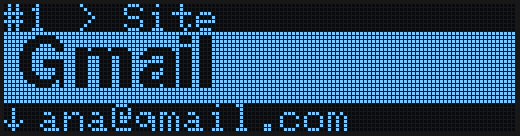
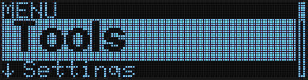
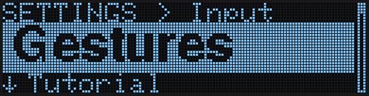
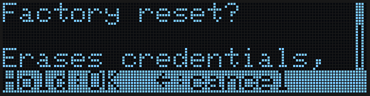
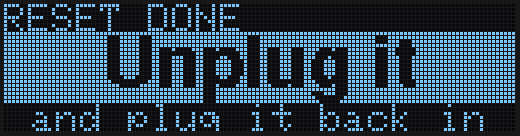

The main menu holds everything that is **not** an account: tools (backups, the Bitcoin wallet, the browser link), settings, the dangerous options (factory reset) and device information. This guide shows how to get there and how to move inside it.

The moves are the same as everywhere else (see [Gestures](/getting-started/gestures)). In **Buttons** mode, use the dot named in brackets.

---

## Getting to the menu

Your accounts and the menu sit on one strip: the menu is to the left of account 1, and **+ Add new** is after your last account.

- From **account 1**, swipe **left to right** (Left). The menu slides in from the left.
- From **+ Add new**, swipe **right to left** (Right).

<Tip>
To get through many accounts quickly, swipe sideways and **keep your finger on the last dot**: it jumps 10 accounts at a time (in Buttons mode, hold Left or Right).
</Tip>

---

## The menu screen

The menu looks like every other screen: where you are in small letters at the top, the selected option big in the band, the next option under it (`↓ …`), and a bar on the right showing your place in the list.

| Item | What is inside |
|------|----------------|
| **Tools** | Export and Import credentials over USB, the **Bitcoin** wallet, and the browser link (**Chrome: On/Off**) |
| **Settings** | Control, Tutorial, Hand, Keyboard, Language, screen reader, password format |
| **Danger Zone** | Factory reset and bootloader mode |
| **Info** | Firmware version, serial number, free slots and build date |

| Move | What it does |
|------|--------------|
| Swipe up or down (Up / Down) | Next or previous option |
| Tap the centre (Centre) | Open the submenu, or run the option |
| Swipe left to right (Left) | Back to the previous menu; from the main menu, back to your accounts (**+ Add new**) |
| Swipe right to left (Right) | Out to account 1, from any menu |

---

## Settings

Each entry shows its current value. Tap the centre to change it; a short notice confirms the new value.

| Entry | What it does |
|-------|--------------|
| **Control: Gestures / Buttons** | Swipe across the dots, or press them one by one. Switching to Gestures runs the tutorial |
| **Tutorial** | Replays the animated tutorial |
| **Hand: Right-handed / Left-handed** | Turns the screen round (Right-handed is the default) |
| **Keyboard: XX-XX** | The keyboard layout of your computer, so symbols are typed correctly |
| **Language: English / Español** | The language of the device |
| **Reader: On/Off** | Keeps the [screen-reader mode](/getting-started/recovery-no-screen) on across restarts |
| **Pwd: …** | The format of random passwords (Symbols, Numeric, a-z 0-9, Aa-z 0-9, Words, Words+Num) |

---

## Tools

| Item | What it does |
|------|--------------|
| Export | Sends all your credentials to the computer over USB (see [Create a backup](/getting-started/creating-backups)) |
| Import | Receives credentials from the computer (see [Import credentials](/getting-started/importing-credentials)) |
| Bitcoin | The Bitcoin wallet: create it, see the seed, export watch-only, sign transactions (see [Bitcoin wallet](/getting-started/bitcoin)) |
| Chrome: On/Off | Lets the [browser extension](/getting-started/browser-extension) find the right account |

---

## Danger Zone

<Warning>
These actions cannot be undone. They ask for confirmation by **holding the centre** (about 1.5 s) — a tap does nothing, and swiping left to right cancels. A border fills around the screen while you hold.
</Warning>

| Item | What it does |
|------|--------------|
| Factory reset | Erases **all** credentials, the PIN and the settings. When it finishes, the screen asks you to unplug the device — it does nothing else until you do. Plug it back in and the [initial setup](/getting-started/setup-wizard) starts |
| Bootloader mode | Restarts the device ready to receive a firmware update |

---

## Info

Shows the firmware version (`SW: 1.1.0`), the device serial number, the microcontroller and security-chip identifiers, how many of the 61 slots are used and the build date. It is read-only.

---

## Next steps

<CardGroup cols={2}>
  <Card title="Gestures" icon="hand-pointer" href="/getting-started/gestures">
    All the moves, on every screen.
  </Card>
  <Card title="Bitcoin wallet" icon="bitcoin-sign" href="/getting-started/bitcoin">
    Create a wallet, export watch-only and sign transactions.
  </Card>
  <Card title="Create a backup" icon="cloud-arrow-down" href="/getting-started/creating-backups">
    First use of Tools → Export.
  </Card>
  <Card title="Broken / no screen" icon="eye-low-vision" href="/getting-started/recovery-no-screen">
    Read the screen over USB if the display fails.
  </Card>
</CardGroup>
