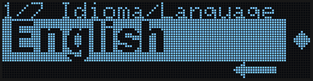
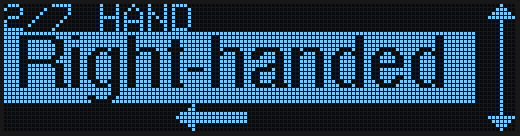
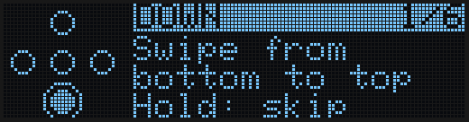
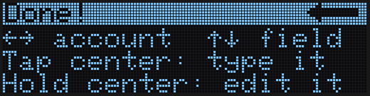
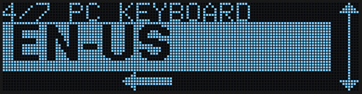
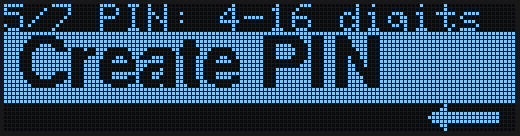
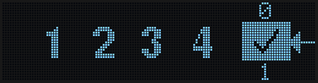
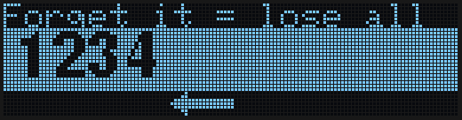
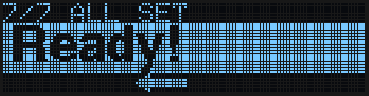
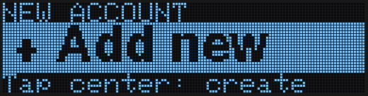

The first time you plug your ZeroKeyUSB into a USB-C port (and after a factory reset), a short setup starts by itself. It has **7 steps** and every one works the same way, with [gestures](/getting-started/gestures):

- **Swipe up or down** to change the value in the big band.
- **Swipe right to left** to go on to the next step.
- **Swipe left to right** to go back.

You never tap to go on, so a stray touch can't skip a step. The animated arrows on each screen show the move: the one sliding along the bottom means "swipe this way to go on"; the double arrow growing on the right edge means "swipe up or down to change".

<Note>
This page describes firmware **1.1.0**. The setup always uses gestures; if you prefer pressing the dots one by one, switch afterwards in **Menu → Settings → Control**.
</Note>

---

## Step 1 — Language

Choose **Español** or **English** by swiping up or down. The title is shown in both languages because nothing has been chosen yet.

*Swipe up or down to change, then right to left to go on.*

---

## Step 2 — Hand

Choose **Right-handed** or **Left-handed**. The screen turns round straight away, so you can see which way feels right before going on.

*Swipe up or down to switch, then right to left to go on.*

---

## Step 3 — Tutorial

A short animated tutorial teaches the moves one at a time: swipe up, down, left and right, tap the centre and hold it. Each lesson shows the move and waits for you to do it; when you get it right it says **Great!**. Holding the centre skips a lesson.

The last card sums up how to use your accounts. Swipe right to left to close it.

<Tip>You can replay the tutorial at any time from **Menu → Settings → Tutorial**.</Tip>

---

## Step 4 — Computer keyboard

ZeroKeyUSB types your passwords as if it were a USB keyboard. So that symbols like `@`, `!` or `#` come out right, it needs to know the keyboard layout of **your computer**.

*Swipe up or down to go through EN-US, DA-DK, DE-DE, ES-ES, FR-FR, HU-HU, IT-IT, PT-PT and SV-SE. When yours appears, swipe right to left.*

<Tip>You can change it later from **Menu → Settings → Keyboard**.</Tip>

---

## Step 5 — Create your PIN

Your master PIN has **4 to 16 digits**. It is the only thing that unlocks the device.

*Swipe right to left to open the PIN wheel.*

On the wheel:

| Move | What it does |
|------|--------------|
| Swipe up or down | Turns the wheel to the number you want |
| Swipe right to left | Adds the number to your PIN |
| Swipe left to right | Erases the last number (with nothing entered, it goes back to the previous card) |
| Right to left on **✓** | Saves the PIN — after each number the wheel stops on the ✓ |

| Add a number | Save on the ✓ |
|---|---|
|  |  |

<Warning>
**There is no PIN recovery.** If you forget it, the only way back is a factory reset, which erases **all** your credentials.
</Warning>

---

## Step 6 — PIN saved

The device shows the PIN you just created, big, **once**, so you can check it. The top line reminds you: forgetting it erases everything.

*Memorise it, then swipe right to left.*

---

## Step 7 — Ready

*Swipe right to left. The PIN screen appears: enter the PIN you just created, the same way, and you reach your accounts. As there are none yet, the first screen is **+ Add new**.*

*Tap the centre to create your first credential — see [Create your first credential](/getting-started/first-credential).*

<Note>
Every time you plug the device in from now on, it asks for the PIN. A wrong PIN only makes you wait before trying again (5 s, then 10 s, 20 s… up to about 43 minutes); nothing is ever erased automatically.
</Note>

---

## Next steps

<CardGroup cols={2}>
  <Card title="Gestures" icon="hand-pointer" href="/getting-started/gestures">
    All the moves, on every screen.
  </Card>
  <Card title="Create your first credential" icon="key" href="/getting-started/first-credential">
    Save your first password with the on-device editor.
  </Card>
</CardGroup>
