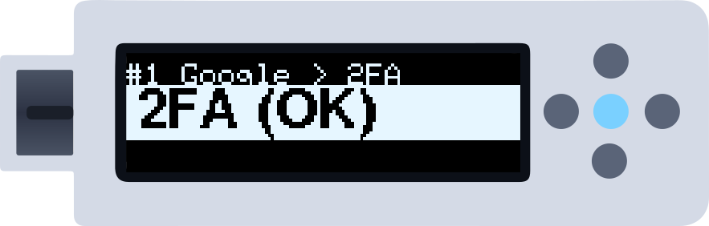
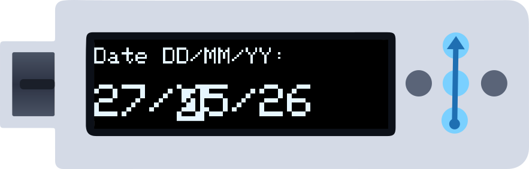
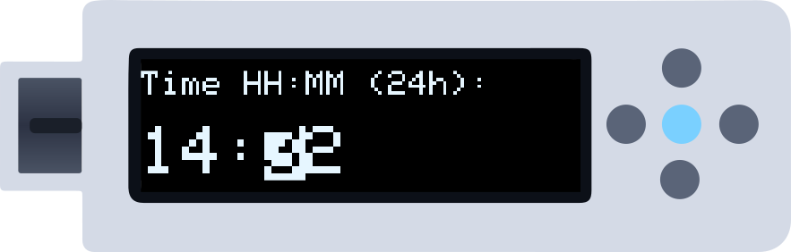
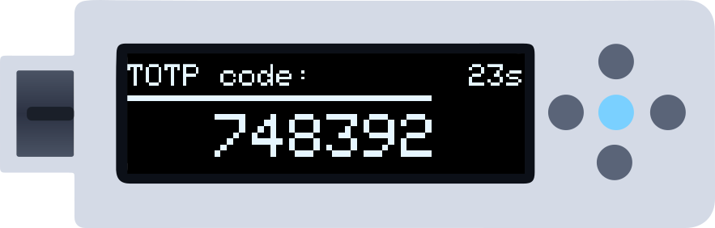

ZeroKeyUSB can generate **2FA codes (TOTP)** fully offline — the same 6-digit codes you'd see in an authenticator app, without a phone. This guide covers how to use them. To add a 2FA secret to an account, see [Import credentials](/getting-started/importing-credentials).

<Note>
**Before you start:** the account must have a 2FA secret loaded. On its 2FA field you then see `2FA (OK)`; `2FA --` means it has none. Load the secret from the web manager first.
</Note>

In the illustrations a **blue arrow** is a swipe and a **lit centre dot** a tap; in Buttons mode press the dot named in brackets.

---

## Step 1 — Go to the 2FA field

On the account, swipe **up** (Down) to go from the site to the user, the password and then **2FA**. Tap the centre (Centre).

---

## Step 2 — Enter the date (once per session)

The device has no clock that keeps time while it is unplugged, so it asks for the date and time **once** each time you plug it in. First the date, as `DD/MM/YY`.

| Move | Gestures | Buttons |
|------|----------|---------|
| Change the selected digit | Swipe up / down | Up / Down |
| Move to the next / previous digit | Swipe right / left | Right / Left |
| Confirm the date | Tap the centre | Centre |

On this screen the selection follows your finger (swipe up = the digit goes up). Keep your finger on the last dot to keep it moving.

---

## Step 3 — Enter the time

The same way, now `HH:MM` in 24-hour local time. Tap the centre to calculate the code.

<Tip>
Use your local time as shown on your clock; the device does not apply a time zone.
</Tip>

---

## Step 4 — The code

The 6-digit code appears. It renews by itself every 30 seconds while it is on screen.

*Put the cursor in the 2FA box of the website or app and **tap the centre**: the device types the 6 digits on your computer and goes back to the account's 2FA field.*

---

## Next codes

While the device stays plugged in, it remembers the date and time: the next time you tap the centre on a 2FA field (in any account) the code appears straight away.

---

## Quick reference

| Screen | Gestures | Buttons |
|--------|----------|---------|
| `2FA (OK)` field | Tap the centre → code | Centre |
| `2FA --` field | No secret loaded: nothing to do | — |
| Date / time | Swipe up/down: digit · right/left: next/previous · tap: confirm | Up/Down · Right/Left · Centre |
| The code | Tap the centre: type it and go back | Centre |

---

## Next steps

<CardGroup cols={2}>
  <Card title="Import 2FA secrets" icon="cloud-arrow-up" href="/getting-started/importing-credentials">
    How to load the secret from your service into an account.
  </Card>
  <Card title="Create your first credential" icon="key" href="/getting-started/first-credential">
    If you have no accounts yet, start here.
  </Card>
</CardGroup>
